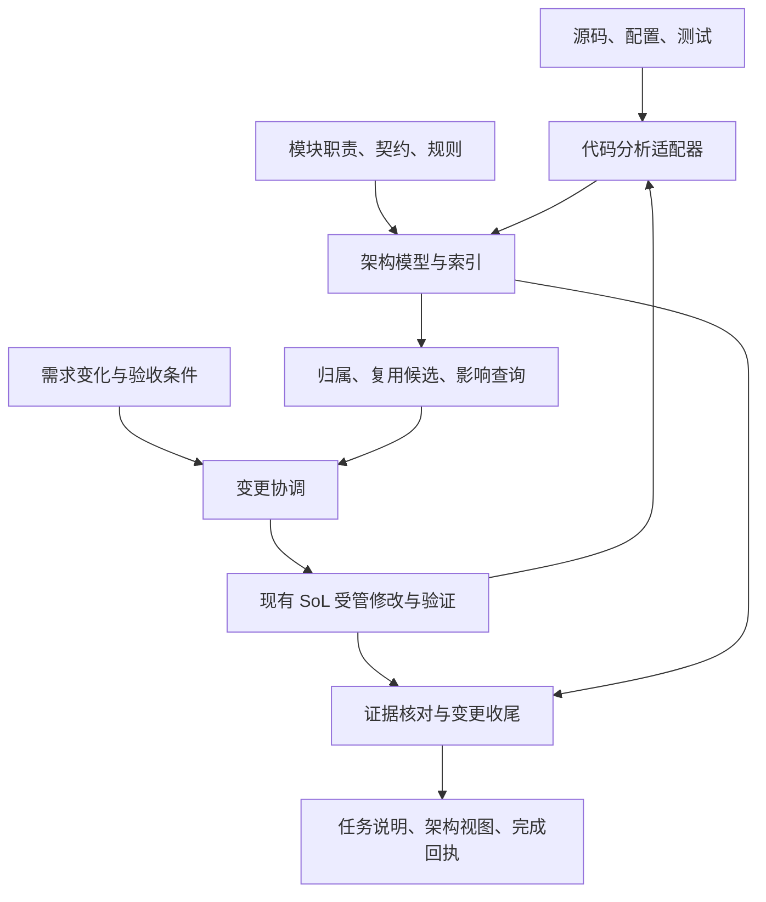

# Codex-SoL V0.1

SoL-Pi 的 Codex 本地适配项目：帮助模型发现并复用项目内已登记的组件，在修改后维护模块职责和公共契约，并用真实检查、复核与恢复记录延续下一次任务。当前主要验证 JavaScript 项目；Windows 宿主证据保留，Linux CLI 接入已在 WSL2 Ubuntu 24.04 验证，范围见 [Linux 使用与验收](fixtures/linux/README.md)。

优先通过[本地插件安装说明](PLUGIN.md)接入；插件标识为 `codex-sol@sol-local`。本仓库保存开发源码，安装前需要依照说明生成兼容插件包。真实模型稳定自主连续任务、完整 Desktop GUI 流程和成本对照仍待验收。

最新更新：[2026年10月6日架构与可靠性更新](CHANGELOG.md#2026年10月6日-架构与可靠性更新)；完整本地验收范围和限制见[架构演进验收](fixtures/architecture-evolution/README.md)。安装入口见[本地插件说明](PLUGIN.md)。远端 workflow 结果尚未核实；真实 GUI / Linux TUI 信任与取消，以及模型 A/B 尚未验收。项目仍处于早期开发阶段。

工程循环等外部控制器可单独分发[只读组件发现 Provider](PROVIDER.md)：保留已登记的 v1 查询，新增免登记的 repository v2 文件库存、来源捕获与调用关系覆盖。该发行只有 query/read/recall 三个工具，写入与任务完成继续由调用方控制器负责。

为受管文件操作提供同步验证回执（Validation Receipt），并将大输出归档成可精确召回的 ObservationPack。项目参考 SoL-Pi commit `1559b5cb12c72da4a485bc50fe326586b216fb19`；[Notion 开工单](https://app.notion.com/p/3e831ddb72338111ada4dffbdd87713b) 保留 V0.1 清单与后续设计。V0.1 接口和范围以本仓库合同为准；下一阶段方向见本文末节。

当前实现与职责树见 [architecture-current.md](architecture-current.md)，设计沿用 [architecture.md](architecture.md)。架构模式已接通查询、Context、变更登记、绑定写入、维护复核与完成、变更状态注入，以及有限宿主范围的 PreToolUse/Stop 门禁和本地插件装配；当前宿主边界见 [Host 验收](fixtures/host/README.md)。IF-004、Context 与 Host 是分阶段证据，不合并成一个模型自主完成声明；旧阶段结果分别保留于 [闭环验收](fixtures/closure/README.md)、[Context 状态验收](fixtures/context-state/README.md) 和 [历史能力验收](fixtures/current-stage/README.md)。

维护、复核与收尾选择性参考原始论文、MIT 课程和 SWEBOK 相关章节，依据见 [软件工程调研](closure-research.md)，已实现合同见 [架构合同 §5.1–5.4](architecture.md#51-架构维护与语义复核)。程序提出事实差异并核验完成条件；LLM 判断契约、修改声明和提交复核。尚未证明模型能稳定自主维护架构。

## MCP 工具

私人博客只作为 Hook 测试夹具。现有 `SessionStart` / `UserPromptSubmit` 已完成该阶段收尾，证据见 [Hook 收尾](fixtures/context/blog-hook-closeout-evidence.json)。MCP 当前路径为查询 → 职责材料 → 产物交接 → 登记 → 绑定写入 → 维护声明与复核 → 累计检查 → 完成发布。

| 工具 | 用途 |
| --- | --- |
| `sol_apply_changes` | 写入或删除多个工作区文件，按实际变化验证。 |
| `sol_apply_patch` | 使用 Codex 原生 patch 引擎应用 Begin Patch 格式并验证。 |
| `sol_read_file` | 归档读取结果；大输出返回有预算的打包结果。 |
| `sol_recall` | 按 handle 精确召回原文。 |

显式启用 Context 后另有 `sol_context_prepare` / `sol_context_submit`；再配置架构声明时增加 `sol_architecture_query` 及 `sol_change_open/status/resume/abandon/review/complete`，共十三工具，两个写入入口要求变更绑定。使用方法见下文。不配置时仍只有上表四工具。

V0.1 原始范围覆盖以上 MCP 工具和按项目配置的 Windows Bash/Shell Hook；架构模式现另有 Context 生命周期、PreToolUse 与 Stop Hook，边界见 [Host 验收](fixtures/host/README.md)。Shell Hook 只包装已配置的 Bash/Shell；架构模式下匹配到的原生 `apply_patch`、`Edit`、`Write` 由 PreToolUse 拒绝并指引显式 MCP 调用，不透明替换当前调用。未匹配的宿主工具、其他 MCP 工具及专业写入工具不受该门禁覆盖。可选架构查询和显式绑定的变更状态 Context 已接入；Reducer、自动 compact 摘要、自动修复和后台验证仍属后续能力。

2026-10-01 的 Windows V0.1 显式 MCP 链路、项目 Hook 路由、验证回执与精确召回已实现。Desktop core 0.159.2 和 TUI 0.159.2 启用可选取消桥接后，分别通过 GUI Stop 与 Esc 中断：目标 `turn_aborted` 取消校验，后台进程和锁释放，部分输出保留。停止到响应分别约 0.7 秒和 0.57 秒；随后修改与旧输出/回执召回通过。该阶段完整检查为 81/81 测试通过，依赖审计 0 个漏洞。

历史无桥接取消失败和 CLI 单次 Hook trust bypass 记录继续保留；当前结果覆盖上述版本的 MCP 桥接与恢复，不覆盖原生 Shell Stop、受限 sandbox、ask 审批或 Linux。未修改全局配置、安装或升级组件，也未重启 Desktop。详见 [acceptance.md](acceptance.md)、[fixtures/manifest.md](fixtures/manifest.md) 和[取消桥接证据](fixtures/t3/cancellation-compat-evidence.json)。

## 接入 MCP

需要 Node.js 20.8 或更新版本。在本目录运行 `npm install`，将 [rules.example.json](rules.example.json) 复制到目标项目并按项目修改。规则命令是固定 `argv`，不由模型生成，也不经 shell。

在目标项目 `.codex/config.toml` 中新增 MCP server，保留已有配置；将尖括号值替换成真实绝对路径。`CODEX_SOL_PATCH_EXECUTABLE` 必须指向安装的 Codex 原生执行文件（Windows `.exe`、Linux ELF），不能指向 `.cmd` / `.bat` shim 或 npm JS 启动器。

```toml
[mcp_servers.codex_sol]
command = "node"
args = ["<Codex-SoL 目录绝对路径>/src/server.mjs"]
env = { CODEX_SOL_WORKSPACE = "<目标项目绝对路径>", CODEX_SOL_RULES = "<目标项目规则文件绝对路径>", CODEX_SOL_PATCH_EXECUTABLE = "<Codex 原生执行文件绝对路径>", CODEX_SOL_GENERATED_PATHS = '["**/__pycache__", "**/*.pyc"]' }
```

`CODEX_SOL_GENERATED_PATHS` 是可选 JSON 数组，用于排除测试生成物；其他语言请替换示例 glob。把目标项目的 `.codex/sol/` 加入 `.gitignore`。

可选的 MCP 宿主取消桥接需在上面的 inline `env` 表中增加 `CODEX_SOL_HOST_EXECUTABLE = "<已安装 Codex.exe 的绝对路径>"`；非法相对路径配置报告 `CONFIG_ERROR`。未设置时沿用 MCP SDK 原有取消行为。设置后仅 `sol_apply_changes`、`sol_apply_patch` 与 `sol_read_file` 使用只读 app-server 查询和对应 rollout 日志中的明确 `turn_aborted` 事件；不会根据其他进程看到的 unfinished-turn 状态推断取消，也不会伪造 `notifications/cancelled`。宿主 metadata、RPC、路径或日志无法核实会 fail closed，返回/记录 `HOST_STATE_ERROR`，不伪报通过、不自动重放。`sol_recall` 和原生 Shell Hook 不经过此桥接。该适配按 Windows CLI 0.159.2 / Desktop core 0.159.2 做过兼容验收，不代表稳定公开 API 或其他版本保证；完整边界见 [contracts.md](contracts.md#8-optional-mcp-host-cancellation-bridge)。

项目 Hooks 还需在同一 `.codex/config.toml` 启用：

```toml
[features]
hooks = true
```

保留文件中已有的 MCP 与 feature 配置；若已有 `[features]` 表，只需合并 `hooks = true`，不要重复定义该表。

## 接入 Windows 原生操作

将 [native.example.json](native.example.json) 复制为目标项目 `.codex/native.json`，再把所有示例路径改成实际绝对 Windows 路径。`node`、`shell` 分别指向实际 Node 与 PowerShell 可执行文件；`shell` 可为项目实际使用的 `powershell.exe` 或 `pwsh.exe`。

在目标项目 `.codex/hooks.json` 中合并以下事件配置，已有 Hook 项目必须保留。命令由 `node` 启动入口，并分别引用入口和配置路径：

```json
{
  "description": "Codex-SoL project hooks",
  "hooks": {
    "SessionStart": [
      { "hooks": [{ "type": "command", "command": "node \"C:/path/to/codex-sol/src/native-hook.mjs\" --config \"C:/path/to/project/.codex/native.json\"", "timeout": 30 }] }
    ],
    "PreToolUse": [
      { "matcher": "^(Bash|apply_patch|Edit|Write)$", "hooks": [{ "type": "command", "command": "node \"C:/path/to/codex-sol/src/native-hook.mjs\" --config \"C:/path/to/project/.codex/native.json\"", "timeout": 30 }] }
    ],
    "PostToolUse": [
      { "matcher": "^Bash$", "hooks": [{ "type": "command", "command": "node \"C:/path/to/codex-sol/src/native-hook.mjs\" --config \"C:/path/to/project/.codex/native.json\"", "timeout": 30 }] }
    ]
  }
}
```

命令开头的 `node` 必须能从 Codex Hook 环境的 `PATH` 找到；`native.json` 中的 `node` 则是 runner 使用的实际绝对 exe 路径。首次使用需信任目标项目的 `.codex/`，并审阅、信任当前精确 Hook 定义；修改后按新的 hash 重新审阅。CLI/TUI 在 `/hooks` 中审阅；Desktop 使用“设置 → 钩子”（Settings → Hooks）。Desktop 聊天输入框里的 `/hooks` 可显示“无命令”，应从设置页检查项目 Hooks。配置是项目级的，不会自动安装到全局，也不要常态绕过 Hook trust。参见[Codex Hooks 文档](https://learn.chatgpt.com/docs/hooks)。Hook 不是绝对安全边界：未信任项目、Hook 未获信任，或使用未匹配/专业工具时，操作可能不经过它。

Codex 按 Git 工作区根发现项目 Hook。把 `.codex/hooks.json` 放在实际 Git 根；若要在嵌套验收目录单独启用 Hook，该目录必须成为独立 Git 根（`git init` 即可，无需提交），否则应把 Hook 配置放在 Codex 实际识别的根目录。确认 `NativeConfig.workspace` 与 Hook 所属项目根一致。

Shell 命令仍由宿主 Shell 工具发起；Hook 在该命令中启动本地 runner，保留宿主选定的工作目录及其 sandbox/token 执行边界，并由配置指定 PowerShell 版本、profile 和超时。PreToolUse 返回 `permissionDecision=allow` 与 `updatedInput`，它有自己的审批语义，不保证保留普通 Shell 的逐命令 ask 提示。当前 CLI/TUI 运行使用 `-a never` 或 `danger-full-access`，受限 sandbox 与 ask 审批尚未验证。失败反馈不会撤销已执行的副作用。

## 接入 Linux 终端

使用 Linux 自身的 Node.js 20.8+、npm 和 Codex；WSL 下将检查工作区放在 Linux 文件系统中。先按 [PLUGIN.md](PLUGIN.md) 从 `codex/linux-adaptation` 分支接入插件；已有该分支工作区可直接安装依赖并打包，无需重新克隆。

需要包装普通 Bash 操作时，另将 [native.linux.example.json](native.linux.example.json) 复制为项目 `.codex/native.json` 并填入实际路径。Linux 的 Node/Bash 路径支持符号链接，并核验执行权限；`load_profile=false` 使用 `--noprofile --norc -c`，`true` 使用 `--login -c`。非交互 Bash 仍会读取继承的 `BASH_ENV`。

插件已有四项 Hook；额外 Bash 包装只合并 `^Bash$` 的 PreToolUse/PostToolUse，保留插件的 SessionStart、写入门禁和 Stop。完整配置、真实原生 Codex 文件的选择、复跑命令与验收边界见 [Linux 使用与验收](fixtures/linux/README.md)。Linux 已验证 Bash 非零退出、路径与权限、原生 patch、锁、超时和 SIGTERM 后恢复，以及真实 Codex app-server 的插件安装/重启装载。TUI 的交互审阅、Esc 中断和 Linux 宿主取消桥接仍需单独验收。

## 检查与详细合同

运行 `npm run check` 可执行项目完整检查。当前原生 Hook 与 CLI/Desktop 内异常验收状态见 [acceptance.md](acceptance.md) 和 [fixtures/manifest.md](fixtures/manifest.md)；Node 定向测试不能替代真实宿主 UI 验收。

- [contracts.md](contracts.md)：接口输入输出、失败语义和边界。
- [runtime.schema.json](runtime.schema.json)：内部 JSON Schema Draft 2020-12，不是 Codex Hook API schema。
- [acceptance.md](acceptance.md)：验收门槛与当前已验证范围。
- [architecture.md](architecture.md)：架构实施合同，规定职责、变更闭环、宿主门禁、插件装配、实施顺序和验收场景；当前实现与未验证项见 [architecture-current.md](architecture-current.md)。

## 本地代码评测

[自评 benchmark](benchmarks/self-eval/README.md) 提供八个固定 JavaScript 任务，可分别准备 A/B 工作区、评分并比较任务成功率、代码合规率和实际组件复用率。它使用行为测试、静态规则及函数执行覆盖，不调用模型；参考答案校准结果保存在 [校准记录](benchmarks/self-eval/calibration-evidence.json)。实际模型任务与 SoL 开关对比仍需另行运行，模型 token、费用和任务耗时尚未采集。

## 下一阶段设计：架构上下文与插件使用（2026-10-01）

本节保留 2026-10-01 起的架构方向、当时方案和进度记录；它们不等于当前实现清单。2026-10-03 已将方向收敛为 [架构实施合同](architecture.md)，后续按该合同实施。V0.1 接口、状态语义和验收边界仍以 [contracts.md](contracts.md)、[acceptance.md](acceptance.md) 为准；[Notion 开工单](https://app.notion.com/p/3e831ddb72338111ada4dffbdd87713b) 保留决策记录。

截至 2026-10-04，Context 写前职责材料、产物交接、会话恢复/提醒及变更状态只读投影均已接入；后续也接入了有限范围的 PreToolUse/Stop 门禁和本地插件打包/加载。Context 字段见 [合同 §14](contracts.md#14-变更状态进入-context)，新门禁与插件边界见 [合同 §15](contracts.md#15-宿主写门禁与本地插件接入)，真实 Host 记录见 [Host 验收](fixtures/host/README.md)。稳定连续模型任务、Desktop GUI 全流程及固定 A/B token/费用效果仍待验证。

首轮设计按职责明确输入、模型输出要求及下游交接，见 [职责与产物合同](architecture.md#42-职责输入与产物交接)和[论文/项目调研](context-research.md)；后续变更状态连接沿用同一职责与产物合同。

下列原型工具和 Hook 矩阵保留为设计历史；当前实际接口以本文 MCP 工具表、M-002 实施记录、Context 合同 §14、Host 合同 §15 与 [当前架构](architecture-current.md) 为准。

### 目标与范围

面向需求持续变化的编程任务，让需求变化有明确归属、已有能力容易发现、架构调整有影响证据。架构能力服务于减少重复探索、无效模型回合和上下文成本，同时保持任务正确性；模块数量、图的完整度和工具数量本身不算收益。

先在当前 JavaScript 项目验证“定位 → 有界上下文 → 受管修改与验证 → 状态更新 → 恢复”的闭环。沿用项目已有需求文档，通过引用连接需求与变更，不复制另一套 PRD。完整架构管理平台、组件模板继承、全语言分析和丰富可视化不作为首轮前置条件。

### 数据结构与职责

采用模块归属多叉树、依赖有向图和能力索引，共用稳定标识。线索二叉树的前驱/后继用于遍历，不能直接表达职责归属、跨模块复用和影响关系。

- **架构声明**：模块职责、稳定身份、父节点、源码关联、公共契约、允许的依赖、设计理由与 planned / active / deprecated 状态。子节点、反向引用和统计由系统派生；普通私有函数留在代码索引中，不逐个登记为架构模块。
- **代码事实**：由分析适配器提取符号、导出、导入和可识别引用；附源码位置、内容指纹、分析器版本和覆盖范围。语言服务无法识别的动态调用保留未覆盖标记。
- **声明与事实核对**：分别保存设计中声明的关系和代码中检测到的关系，定位漂移；文件哈希刷新不能证明契约准确或没有重复实现。
- **能力查询与任务上下文**：返回相关模块、复用候选、使用示例、契约、影响面、规则和测试入口。默认有界摘要，按需展开与召回；无命中仅表示当前检索范围内未找到。
- **变更协调与证据**：关联需求来源、涉及模块、验收条件、复用/扩展/新增理由与真实检查结果。dirty / checking 等运行状态与架构模块生命周期分开；状态绑定工作区、变更和源码快照。

架构声明、规则与必要变更记录随项目维护；生成索引可重建，临时运行状态与不可变证据分开存放。声明与运行数据的位置、首轮分析粒度和收尾条件见 [架构实施合同](architecture.md)。



图表示数据流；这些职责可先放在一个本地模块化服务中，不要求分别部署进程。

### 参考项目与复用边界

| 参考 | 已核实机制 | 采用方式与限制 |
| --- | --- | --- |
| [Normify](https://github.com/yan-mc/dsh-normify/blob/ed404e5b8db0010ff57ec8486ec8749421072545/src/engine/types.ts) | 模块声明、parent 派生树、API/出向依赖、规则与变更生命周期。 | 优先验证复用独立 engine，再做薄 Codex 适配。原包入口依赖 DSH；文件指纹、模型校验和上游 verified 不能替代真实接口核对及代码测试。 |
| [Aider RepoMap](https://github.com/Aider-AI/aider/blob/main/aider/repomap.py) | Tree-sitter 提取定义/引用，构建文件关系图，结合任务线索与 PageRank 选择预算内摘要。 | 借鉴相关性排序和渐进读取；其引用匹配用于上下文选择，不当作精确调用图。 |
| [Serena](https://github.com/oraios/serena/blob/main/src/serena/tools/symbol_tools.py) | 经语言服务查询定义、实现和引用。 | 评估通过适配器调用现有能力，避免自建全语言分析平台；记录语言服务与动态行为的覆盖边界。 |
| [jscpd](https://github.com/kucherenko/jscpd) | 复制检测，以及实验性语义相似候选。 | 重复候选辅助审查；相似不等于应合并，不自动删除或合并组件。 |
| 当前 Codex-SoL | 实际改动检测、串行验证、取消、回执与精确召回。 | 复用现有执行和证据链路，不另建一套 runner、store 或 recall。 |

Normify 复用还需验证工作区路径约束、跨进程写入、构建半写和关闭失败状态；详见 Notion 的既有源码研究。上述外部项目的完整运行测试、适配和组合收益尚未验证。

### LLM 如何使用

用户仍用自然语言提需求，例如“给上传功能加失败重试，取消上传时也停止重试”。模型拿到相关网络/上传契约，检索现有重试与取消能力，核对使用方，再决定复用、扩展或新增。

确定性规则、状态迁移、证据新鲜度和操作门禁由程序执行，任务上下文由按需查询与生命周期注入提供。沿用 Notion 已确认约束：首个验证不新增 Skill 或 AGENTS.md 承担运行时职责。Skill 仅作为后续可选语义工作流入口，不以技能触发或模型自述代替后端检查；是否加入另行评估。

下表保留 2026-10-01 的工具接口草案；其中的旧名称未必与后续实际接口同名，状态以对应合同为准：

| 工具 | 预期职责 | 当前状态 |
| --- | --- | --- |
| `sol_brief` | 按需求返回相关模块、复用候选、约束和待检查项。 | 拟新增 |
| `sol_lookup` | 按需查询公共接口、源码依据、示例和引用。 | 拟新增 |
| `sol_change_open` | 保存范围、验收条件和复用/扩展/新增理由。 | 已按合同实现，见 §12 |
| `sol_apply_patch` / `sol_apply_changes` | 修改后返回实际变更与同步验证回执。 | 已实现；架构模式的有限 PreToolUse 门禁见 [Host 验收](fixtures/host/README.md) |
| `sol_change_close` | 核对模型更新、检查证据与未解决事项，生成收尾结果。 | 已由 `sol_change_review` / `sol_change_complete` 分开实现，见 §13 |

预期流程：需求 → brief / lookup → 确认归属与方案 → change_open → 受管实现 → 更新相关架构 → 验证 → change_close。普通问答保持只读，小改动不强制新增模块；复用已有组件前仍核对行为和兼容性。

### Codex 插件与本地运行

一个可安装、可启停的插件包承载 manifest、本地 MCP、Hooks 与运行时；SoL 和 Architecture 保持独立职责，插件包不要求包含 Skill。安装后在目标项目配置工作区及规则，依实际宿主要求启用并审阅 Hook。

MCP 采用本地 STDIO：Codex 连接时按配置启动 Node.js 服务，通过标准输入/输出通信。现有 `src/server.mjs` 已使用该模式；无需域名、云服务器或开放监听端口，也不要求用户手动维护常驻服务。2026-10-01 的设计记录当时仍待实现启动配置和打包；本地 package 与实际插件加载现状见 [Host 验收](fixtures/host/README.md)。索引、规则与归档在本地处理，返回给 Codex 的摘要和按需源码仍会进入模型上下文。

拟采用的生命周期接入：

- SessionStart（含 compact 恢复）：提供架构入口、能力状态与未完成变更。
- UserPromptSubmit：按需注入短任务上下文；不因普通问答创建变更。
- PreToolUse：在已启用的受管路径核对范围与依据；必要时拒绝支持的调用并给出可操作诊断。
- 修改完成后：由唯一事件生产者报告实际变化，使相关索引与旧证据失效；不同时让 Hook 与 MCP 重复生产事件。
- Stop：仅对本次已登记变更核对收尾项，限制自动续跑，不反复阻止结束。用户中断保存未完成状态，不重启任务。

受管入口内检查是后端约束，Hook 仅覆盖宿主支持且已启用、已信任的路径；不能宣称覆盖所有工具或全局防绕过。本段矩阵是 2026-10-01 的待验收设计；后续本地插件与限定宿主门禁实测见 [Host 验收](fixtures/host/README.md)，仍不等于 Desktop GUI 或全部宿主路径已通过。

### 最小验收与效果计量

- 能从真实任务定位已有公共能力、核对候选并说明采用或不采用理由。
- 修改共享接口后列出已识别的使用方及未覆盖关系，并提供相应检查证据。
- 源码已变化但架构说明未复核时保持待复核；不能只刷新指纹就报告一致。
- 验证失败、skipped、stale、中断、并发变化或归档失败不误报完成；恢复后旧证据重新核验。
- 同一任务比较现有 V0.1 与新增能力，计入上下文注入、工具描述、索引维护、召回和重试的完整开销。记录成功结果、额外模型回合和总耗时；无可靠 token/计费字段时仅报告字节代理，不声称节省比例。

官方接入依据：[插件包装](https://developers.openai.com/plugins/build/plugins)、[MCP 与 STDIO](https://learn.chatgpt.com/docs/extend/mcp)、[Hooks](https://learn.chatgpt.com/docs/hooks)、[Skills 的按需加载](https://developers.openai.com/codex/skills)。文档能力不等于本项目当前宿主已验收。

2026-10-03 已核对官方上下文能力并收敛 Context 开工范围，见 [架构合同 §4.3](architecture.md#43-官方能力边界与-m-000-开工范围)：先完成“定位与方案材料 → 校验方案产物 → 实现职责材料”的交接。两个入口当时已实现并通过真实 STDIO 测试，但尚未在 Desktop / CLI 会话中验收；后续 0.160 private app-server 的生命周期恢复、提醒与实际 compact 结果见 [Host 验收](fixtures/host/README.md)。独立线程编排随后验收，`thread/fork` 会复制历史。

注入分工见 [架构合同 §4.4](architecture.md#44-hookmcpskill-的职责与注入位置)：Hook 在生命周期时点提供恢复、变化提示和门禁反馈；MCP 的 server instructions / 工具描述说明使用方法，调用结果提供当前职责材料并校验交接；可选 Skill 按需提供语义工作方法。职责配置、输出结构和任务状态各有唯一来源，首轮无新增 Skill、无新增 Hook 即可验证 MCP 闭环。

## Context 首轮使用

将 [context.example.json](context.example.json) 复制为目标工作区内的职责配置，按项目调整 `sources`。在上面的 MCP `env` 中增加 `CODEX_SOL_CONTEXT_RULES = "<工作区内职责配置文件的绝对路径>"`；留空不启用。配置变化在每次调用时重读，旧准备结果与旧交接产物将失效。无需新增服务、Skill 或 Hook；本轮没有修改用户的宿主配置。

示例配置含 `plan` 和 `implement`：前者读取 README 与本次目标文件，要求方案、约束、未解决项；后者接收已接受方案的映射字段及当前目标文件。`consumers.fields` 的键为下游字段，值为上游字段；`blocking_field` 必须传给所有消费者。`notes` 可留在上游原文，默认不转交。

1. 调用 `sol_context_prepare`，例如下列参数（`targets` 替换为真实目标路径）：

   ```json
   {"task":{"id":"context-demo","goal":"检查已有受管写入能力","constraints":["优先复用现有实现"]},"role":"plan","targets":["src/server.mjs"]}
   ```

2. 读取本职责包；`status=blocked` 时先解决必需缺口。源码仅提供有标记的开头摘录，`omitted_bytes` 非零时按 `sources[].raw.handle` 召回所需原文；包中 `omitted` 标明其他省略项。输出 Schema 超预算时按包的 `raw.handle` 展开后再生成产物。
3. 按当前 `output_schema` 输出，调用 `sol_context_submit`，传入 `context_handle=prepare.raw.handle`、同一 `task_id` / `role` / `version`、`output` 和可选 `evidence_handles`。只核验顶层 `evidence_handles` 指向的归档，文本中其他引用仍需模型核对。返回 `accepted=true` 不表示测试通过，`task_complete` 始终为 `false`。
4. 再次 prepare，保持完整 `task` 身份、目标和约束一致，改为 `role=implement` 并传入 `upstream_handle=submit.raw.handle`。只能消费配置允许的上游产物；来源变化、任务不匹配或引用损坏会拒绝交接。上游未解决项保留为阻塞。

完整 Context 工具文本结果上限 4096 UTF-8 字节；任务约束、版本和阻塞项不截断，无法容纳时报告 `CONTEXT_BUDGET`。源码单文件上限 1 MiB，配置 128 KiB，提交 64 KiB，归档记录 256 KiB。现阶段每次 prepare 都返回完整有界包，重启后用持久 handle 重建；会话交付去重与差量优化尚未接入。共享锁串行化受管操作，外部编辑通过来源内容指纹核对；版本只覆盖选定来源，不表示全仓库或检查证据有效。

首轮切片（2026-10-03）只做写前材料交接；修改后的产物、任务状态、代码检查关联和收尾随后按 M-002 接入，变更状态 Context 再按本文末节接入。可选 Skill、独立线程及 Desktop Context 验收仍未完成。首轮 MCP Context 使用 SDK 取消信号，未接入可选宿主取消桥接。

验证：2026-10-03 `npm run check` 为 **104/104 测试通过、依赖审计 0 漏洞**。Context 的 11 项测试和生命周期 Hook 的 12 项测试覆盖交接、旧工具兼容、版本/引用/字段失败、预算召回、阻塞、取消、会话隔离、恢复期间的新任务绑定和按需过期提示。未新增依赖；lint / format / typecheck 仍未配置。

真实 CLI 0.158.0 已用现有 ChatGPT 登录完成只读 `plan prepare → submit → implement prepare → recall → submit`；源码 SHA 保持一致，两个产物均接受且 `task_complete=false`。未明确的重试策略会正确阻塞下游。验收发现读取工具缺少注解会触发审批，已补齐非破坏性注解；两次行召回范围错误仍保留，纠正后成功。详见 [Context 宿主证据](fixtures/context/cli-evidence.json)。此证据不表示重试功能已实现或取得 token 收益。

## 可选 Context 生命周期 Hooks

在目标项目启用 `features.hooks` 后，把以下项分别合并到已有 `.codex/hooks.json` 的对应事件数组，保留其他 Hook；替换工作区、服务目录及两份配置的路径，并按项目生成目录调整 JSON 数组。按前文流程审阅并信任每项精确定义。

```json
{
  "hooks": {
    "SessionStart": [{
      "hooks": [{
        "type": "command",
        "command": "node \"C:/path/to/codex-sol/src/context-hook.mjs\" --workspace \"C:/path/to/project\" --rules \"context.json\" --validation-rules \"rules.json\" --generated '[\"**/__pycache__\",\"**/*.pyc\"]'",
        "timeout": 30
      }]
    }],
    "UserPromptSubmit": [{
      "hooks": [{
        "type": "command",
        "command": "node \"C:/path/to/codex-sol/src/context-hook.mjs\" --workspace \"C:/path/to/project\" --rules \"context.json\" --validation-rules \"rules.json\" --generated '[\"**/__pycache__\",\"**/*.pyc\"]'",
        "timeout": 30
      }]
    }]
  }
}
```

Hook 和 MCP 必须指向同一工作区、同一职责配置。未绑定的旧会话仍可只传 `--workspace` / `--rules`；绑定会话还必须显式提供与 MCP 相同的 `--validation-rules` 和 `--generated`，独立 Hook 不继承 MCP 专属 env。也可在 Hook 进程环境中显式提供已有变量 `CODEX_SOL_WORKSPACE`、`CODEX_SOL_CONTEXT_RULES`、`CODEX_SOL_RULES` 和 `CODEX_SOL_GENERATED_PATHS`。绑定时 Hook 核对规则及 generated 合成 SHA 是否匹配当前持久变更的 `rules_sha`；缺路径或不匹配返回 `CHANGE_UNAVAILABLE`，不会把缺失排除项当默认值。未配置 Context 时不注入。

Windows 上请沿用样例中的 `node "入口路径"`，确保 Hook 的 PATH 能找到 Node。CLI 0.158.0 会用当前环境的 Shell 执行命令；PowerShell 中仅写 `"Node 可执行路径" "入口路径"` 不会调用 Node，显式执行路径需用 PowerShell 的 `&` 调用形式。项目可信与 Hook 定义可信是两项检查：绕过 Hook 审阅不会启用不可信项目的 `.codex/`。隔离自动验收可用 `-c 'projects={"d:\\path\\to\\project"={trust_level="trusted"}}'` 临时声明精确项目；CLI 的 `projects."路径".trust_level` 会保留键内的引号，不能正确匹配路径。日常使用仍按宿主的项目信任与 Hook 审阅流程设置。

每次成功 prepare 使用 Codex 的真实 thread / turn 元数据，把本会话绑定到准备结果；普通 MCP 客户端没有该元数据时仍可使用工具，但不自动绑定。指针位于 `.codex/sol/context-sessions/`，任务和产物仍在原归档中。一个会话只恢复最后一次明确准备的职责，不推测其他聊天的任务。

`SessionStart` 的 startup / resume / clear / compact 仅恢复本会话明确绑定的职责及变更。同一变更 ID 的管理版本可更新，但 task.id / goal 必须匹配；恢复按 read → prepare → `expectedHandle` bind。若旧 producer stale，返回 stale 状态、旧材料引用和独立核验的当前 change_state，不 bind，也不把旧材料称为 ready；当前完成证据有效时保留 `task_complete=true`，不要求重做实现。恢复不依赖启动时 MCP 已连接，也不自动提交产物、执行修改或判断完成。未绑定 Context 继续旧来源恢复规则。

`UserPromptSubmit` 对未绑定会话、当前有效且无阻塞的材料输出 `{}`；变更状态、阻塞或核验错误时才提供 prior task 短提醒。它不关键词分类、不自动绑定、不新建归档或改会话/变更指针、不启动 runner、不保存用户 prompt，也不阻止发送。提醒中的任务和阻塞字段是数据，不覆盖指令；坏归档/配置明确报告 unavailable。更多历史 Hook 证据见 [提示 Hook 证据](fixtures/context/prompt-hook-evidence.json)。事件字段依据 [官方 Hook 文档](https://learn.chatgpt.com/docs/hooks#userpromptsubmit)。

早期未捕获事件的尝试保留为历史证据；后续排查定位到夹具的项目路径键和 PowerShell 命令调用问题，Context 核心无需修改。该早期阶段的实际 compact、Desktop Context 和交互式信任界面仍待验收，PreToolUse 的变更范围门禁和 Stop 收尾也尚未接入；后续 0.160 app-server 的 compact 及新门禁结果见 [Host 验收](fixtures/host/README.md)，Desktop GUI 仍未验收。变更状态只读注入不构成这些新门禁。

2026-10-03 CLI 0.158.0 已通过五次真实 Hook 调用：startup 入口、未绑定静默、来源过期提示、resume 恢复、恢复后静默。模型确认收到 stale，并在不调用工具的回合回报了 Hook 注入的精确恢复引用。两项 Hook 用审阅哈希进行本次调用的正常信任校验，未使用 bypass；三个模型回合源码均未变。完整检查 **104/104、依赖审计 0 漏洞**。见 [实际 Hook 证据](fixtures/context/host-hooks-evidence.json)。

可用已有 CLI 和登录显式复跑真实宿主验收（会调用模型）：

```powershell
node fixtures/context/run-hooks.mjs --codex "<已有 codex.exe 的绝对路径>"
```

脚本在忽略的 `slop/` 创建含空格路径的独立工作区，用 `hooks/list` 预检两项精确定义，按当前哈希设置仅本次调用的信任，不使用 trust bypass、不改全局配置。验证启动入口、过期提示、resume 恢复及有效材料静默；模型需回报实际恢复引用，三个模型回合的源码哈希必须不变。过期提示阶段暂时省略 SessionStart，以免它先恢复材料而遮蔽 UserPromptSubmit 的过期路径。原始诊断和最终 evidence.json 留在该次 slop 目录。

## 可选架构索引：归属、复用与影响

M-001 固定复用 Normify 0.5.4 engine，许可证和原文件来源见 [vendor/normify](vendor/normify/README.md)。声明树、UID、结构与 policy 使用上游实现；薄适配器用 Acorn 解析真实 JavaScript ESM 的静态导入和导出，返回位置、内容 SHA、模块归属、已有能力及反向导入方。

在已有 Context 配置顶层增加 `"architecture": {"path": "architecture.json"}`；在需要这些材料的职责对象增加 `"architecture": true`。只给相应职责注入，其他职责保留原行为。服务启动时启用声明会注册架构查询及六项变更操作，共十三工具，同时要求两个写入工具显式绑定变更；改变工具配置后重启该 MCP 实例。[architecture.example.json](architecture.example.json) 是本仓库当前模块声明示例，不应直接复制到其他项目。

模型调用 `sol_architecture_query({paths:["src/server.mjs"],capability:"escapeHtml readPosts"})` 找归属与复用候选，再在 `sol_context_prepare` 传 `architecture_query` 选材。关键词是字面匹配；空关键词列出登记能力。超过 4096 字节的材料明确给出省略数量与原文引用，用 `sol_recall` 展开。准备结果和提交核对包括整个已登记索引的来源；即使目标文件未变，其他登记源码变化也使旧 Context 过期。

声明的 rpc 能力须对应真实 ESM 导出；指纹漂移、导出缺失、重叠归属或禁止依赖保留阻塞。动态导入、require、外部包、未登记目标及非 JavaScript 来源明确列为未覆盖；反向导入关系只表示文件依赖。revision 是操作者声明的元数据，当前适配器不校验 Git 历史；有效性依据当前来源 SHA 和声明指纹，不能据 revision 或编译成功判断任务完成。无 Git 历史的博客夹具使用 40 个零作为占位并明确未核验。

本轮 `npm run check` **112/112，依赖审计 0 漏洞**；新增 8 项架构检查覆盖上游独立编译、UID 改名、真实依赖政策、导出删除、越界/链接/解析/取消、版本失效和真实 STDIO。新增运行依赖 acorn 8.15.0、yaml 2.8.3；lint / format / typecheck 未配置。本仓库示例编译得到 19 个模块、38 项能力、58 条静态导入关系，当前无阻塞。

独立本地验收项目在 `D:/codex-sol-private-blog-test`，通过真实交互 TUI 创建。它有共用 HTML 转义、文章读取、首页与文章详情组件，12 项测试及 Edge 浏览器检查通过。标签需求用于查询和写前职责交接，尚未实施标签功能；截至该次历史验收，变更登记、写入门禁与收尾仍待 M-002，后续交付见本节及 [闭环验收](fixtures/closure/README.md)。实际模型调用和边界见 [博客 TUI 证据](fixtures/architecture/blog-tui-evidence.json)。

真实 TUI 模型完成查询、方案提交和首次下游准备（依据不足而 blocked），补读后新方案 accepted 且无阻塞。CLI 账号额度随后耗尽，第二次 TUI 下游准备未执行；父 agent 用实际 STDIO MCP 消费同一模型产物，返回 ready，证据分别记录。31 次 TUI 工具调用含 7 次召回范围失败，纠正记录保留，不据此声称 token 或成本收益。

## Hook 阶段收尾与 MCP 接续（2026-10-03）

按用户纠正，博客只用来验证 Hook，不再为它规划或实施标签功能。新增 [run-blog-hooks.mjs](fixtures/context/run-blog-hooks.mjs)：在指定夹具里临时安装测试 Hooks，核对精确定义哈希信任，等待真实 `turn/completed` 后检查回调；结束恢复原配置并关闭自建宿主/MCP 进程。只改夹具 slop 中的探针以触发过期，博客源码、数据与样式 SHA 保持不变。

截至 2026-10-03，博客上四次实际 app-server 0.158.0 回调通过：startup 入口、无绑定静默、有效材料静默、来源变化的 stale 提醒。夹具包装器在 UserPromptSubmit 之后停止推理，核心结果仍原样记录，核心不阻止用户发送。现有 Context Hook 12 项及 Native Hook 5 项回归通过；此前五次真实 CLI 注入及模型确认的证据保留。实际 compact 与 Desktop Context 仍未验收；当时的收尾限定于已实现的生命周期 Hooks，变更范围门禁和 Stop 完成核对在当时仍待接入。

MCP 已开始接续：初始化用同一份职责配置注册工具和说明；Context/architecture JSON 原文是单行，先用 `sol_recall` 的 `selector:{kind:"lines",start:1,end:1}`，有 `next_cursor` 时保留原 handle/selector 继续。越界仍返回 INVALID_RANGE，并给出实际可用行数或字节范围；空原文提示 bytes 0..0。真实 STDIO 已验证拒绝越界及修正后的精确召回，默认四工具、Context 六工具、架构七工具保持兼容。

本轮完整 `npm run check` **113/113，审计 0 漏洞**，新夹具 `node --check` 通过；格式化、lint、typecheck 未配置。复跑仅针对现有测试夹具和已有 CLI：

```powershell
node fixtures/context/run-blog-hooks.mjs --workspace "<Hook 测试夹具绝对路径>" --codex "<已有 codex.exe 绝对路径>"
```

## MCP 变更登记与写入绑定（M-002 首片）

首片交付时架构模式提供十一工具；本节保留当时登记与绑定流程，当前增加复核与完成入口后为十三工具。默认四工具和纯 Context 六工具保持兼容：

1. `sol_architecture_query` 查归属、已有能力与影响，保留 `raw.handle` 和 `version`。
2. `sol_change_open` 登记 `task:{id,goal}`、`requirement_ref`、`scope:[{path,module_uid}]`、`acceptance`、`expected_architecture_version` 和 `reuse:{decision,reason,query_handle,capability?}`。decision 为 reuse / extend / new / not_applicable；reuse / extend 必须选中查询里已验证的 `{uid,symbol}`。新文件、文档、配置显式指定已有模块 UID。
3. `sol_apply_changes` / `sol_apply_patch` 在原参数之外传 `change:{id,version}`。使用该次返回 `change.change` 中的新绑定继续；部分失败也需要读取返回状态。全部目标先检查，patch 移动源/目标都必须在范围内。
4. 用 `sol_change_status({})` 找回当前记录。发现来源变化时版本更新、旧证据失效；范围外变化列出具体路径。调整范围调用同一个 `sol_change_open`，增加 `change`，重新引用有效查询；累计变化不能移出范围。
5. interrupted 需要先检查真实改动，再 `sol_change_resume({change})`；结束试验可 `sol_change_abandon({change,reason})`，保留文件和历史。

当前一个工作区同时一条可写变更，明确绑定，不按聊天自动猜测。记录复用 ObservationStore 原文归档，指针发布复用原子 JSON 和工作区锁。取消、进程退出和最终归档失败保留已发生修改；没有自动重放或回滚。无实际变化不运行新检查、不增加证据 generation。原 SoL 验证事件只生成一次。

状态包上限 4096 UTF-8 字节；需求、范围、验收、累计路径、回执和历史链用 `sol_recall` 召回 `raw.handle`，单行从 lines 1..1 开始。完整输入快照复用已有 generated 排除配置，大项目先配置生成目录（如 node_modules、构建产物）；输入元数据超过 128 KiB 会明确失败，生成目录不能作为管理目标。

首片当时只有登记、调整、绑定、失效与恢复，结果保持 `task_complete=false`；后续 IF-004 与 Context 变更状态按下节接入。首片回归位于 `tests/change.test.mjs`，其中原生 patch 案例使用 `CODEX_SOL_PATCH_EXECUTABLE` 指定已安装 CLI，不调用模型。

本片完整 `npm run check` **124/124、0 跳过，依赖审计 0 漏洞**；已配置本机已有 CLI，原生 patch 案例实际运行。源码语法检查和 `git diff --check` 通过；lint / format / typecheck 未配置。更新后的本仓库声明树为 **20 模块 / 41 登记能力 / 66 静态导入关系**，无阻塞；当前索引证据见 [change-index-evidence.json](fixtures/architecture/change-index-evidence.json)，不覆盖旧阶段证据。

## MCP 架构维护、复核与完成收尾

2026-10-04 接入 IF-004。沿用上述配置，架构模式新增 `sol_change_review` 和 `sol_change_complete`，服务共十三工具；没有新增依赖或配置变量。

1. 完成受管修改后，调用 `sol_change_review({change,phase:"prepare"})`。材料含初始/当前源码引用、事实差异、累计影响、逐规则检查计划及阻塞项。使用 `sol_recall` 读取 `raw.handle`，单行 JSON 从 lines 1..1 开始，同一 selector 跟随 cursor。
2. LLM 核对职责、公共输入输出、错误、副作用、兼容性与使用方。需要维护 source、API 或契约时，通过原受管写入入口更新声明，再 prepare；新增源码不会自动登记，刷新指纹也不代替复核。
3. 调用 `sol_change_review({change,phase:"submit",review_context_handle,review})`。review 必须逐项覆盖所有 affected UID、验收索引和 uncovered 索引，引用本次材料中的自身来源；纯资料免代码检查需明确理由。完整字段以 `src/architecture/change.mjs` 的 `changeReviewSchema` 和 [合同 §13](contracts.md#13-架构维护复核与完成收尾if-004) 为准。任何未解决项保持未完成。
4. 使用 submit 返回的新绑定调用 `sol_change_complete({change,review_handle})`。协调器检查当前复核、声明及累计必需规则，复用允许且有效的历史检查，补跑缺失/过期检查；证据归档和最终发布前核验都成功才返回 `state="completed", task_complete=true`。
5. 后续 `sol_change_status` 重新核验输入、执行条件及归档。完成后源码改变、执行文件改变或证据损坏，会恢复 dirty；中断需显式 resume，不自动重放。历史记录保留，下一项任务可查询已维护的能力后新登记。

规则的 `globs` 表示触发/覆盖路径，`watch_paths` 表示检查输入依赖，两者不同。累计影响中的源码/配置没有适用规则时阻塞完成；架构声明由已有 Normify 校验覆盖。收尾补跑使用 ValidationEngine 显式再验证，不产生假 ChangeEvent，也不写源码触发测试。

`Rule.reuse` 可选，默认 `"never"`，因此旧配置仍执行真实检查。只有项目确认重要文件输入已覆盖、无未跟踪外部条件时才设 `"watched_inputs"`；系统核验实际保存的输入、规则、命令、排除设置、运行条件与输出归档。scope 管理调整使复核失效，但不会仅因 latest_validation 为空而重复执行仍有效的检查。

**完成收尾的当前限制**：检查命令 `argv[0]` 必须是能核验的实际绝对执行路径；通过 PATH 查找的 `python` / `node` 可以运行，但无法发布 completed。`rules.example.json` 的 `python` 是便携示例，启用收尾前需要替换为本机实际路径。规则文件变化需要重启 MCP，再显式调整变更并重新复核；服务器不会默用旧命令。旧变更缺初始事实时报告 `BEFORE_IMPACT_UNAVAILABLE`，不会把当前图补成历史。

IF-004 交付时的证据见 [闭环验收](fixtures/closure/README.md)，当时声明树为 **20 模块 / 44 登记能力 / 66 静态导入关系**。真实 STDIO 覆盖查询、受管修改、分页召回、复核、完成与状态读取；这不是新增 Desktop/TUI 模型回合验收。其后变更状态 Context 注入已接入；当前声明索引与 PreToolUse/Stop 门禁、插件、模型效果边界见下节。

IF-004 阶段最终 `npm run check` **180/180、0 跳过、依赖审计 0 漏洞**，已安装 CLI 原生 patch 实际执行。相关源码语法及 diff 检查通过；格式化、lint、typecheck 未配置。运行输入与日志 SHA 见 [检查记录](fixtures/closure/check-evidence.json)。

## Context 中的变更状态（2026-10-04）

`sol_context_prepare` 的 `change` 是可选显式绑定。绑定使用当前 `sol_change_open` / `sol_change_status` 返回的 `id` 和持久 `version`；`task.id` 与 `goal` 必须和该变更一致。`targets` 仍只选择读取材料，不扩张写入 scope；以前未绑定的 plan 产物不会因后来 open 而自动绑定。字段、刷新语义和恢复边界见 [合同 §14](contracts.md#14-变更状态进入-context) 与 [架构设计 §4.13](architecture.md#413-变更状态的职责注入合同已实现)。

例如，先登记变更，再以 open 返回的当前绑定、完全相同的 task identity/goal prepare 并 submit plan；下例是随后为 implement 使用该产物和同一当前版本：

```json
{"task":{"id":"upload-retry","goal":"为上传失败增加重试并在取消时终止重试","constraints":["只修改登记范围"]},"role":"implement","targets":["src/upload.mjs"],"upstream_handle":"<同一任务已接受的 plan artifact handle>","change":{"id":"<当前变更 id>","version":"<当前持久版本>"}}
```

返回的 `change_state` 是核验后的只读投影。`latest_validation.interpretation='historical_only'` 不表示当前累计检查通过；只有当前核验为 completed 才有 `task_complete=true`。出现漂移或遗留操作时先调用 `sol_change_status` 获得已发布的新绑定，再继续写入。

绑定会话的生命周期 Hook 必须显式使用与 MCP 相同的规则和 generated 配置。下列是 PowerShell 环境下的完整单条命令；完整的两个事件数组配置见上方 [可选 Context 生命周期 Hooks](#可选-context-生命周期-hooks)：

```powershell
node "C:/path/to/codex-sol/src/context-hook.mjs" --workspace "C:/path/to/project" --rules "context.json" --validation-rules "rules.json" --generated '["**/__pycache__","**/*.pyc"]'
```

Hook 只对已绑定会话加载验证配置，并核对规则与 generated 合成 SHA 是否符合变更记录的 `rules_sha`；缺失或不匹配时报 `CHANGE_UNAVAILABLE`。无绑定的旧会话恢复不要求新增验证配置。SessionStart 可 prepare 新 Context 归档并以 `expectedHandle` 更新会话指针；UserPromptSubmit 的只读提醒不新建归档或修改会话/变更指针。两类核验都不发布变更状态、不启动 runner；此 Context slice 当时尚未覆盖 PreToolUse/Stop 新门禁。Context slice 的索引 **20/44/70** 与完整 `npm run check` **199/199、0 跳过、审计 0 漏洞**，以及 59 个输入 SHA 记录，仍见 [Context 状态验收](fixtures/context-state/README.md) 和 [当时检查记录](fixtures/context-state/check-evidence.json)。IF-004 的历史 **180/180** 与 66 条索引仍保存在 [闭环检查记录](fixtures/closure/check-evidence.json)。后续 Host 状态见下节。

## Host 门禁与本地插件验收（2026-10-04）

Host 证据只描述本轮真实 0.160 private app-server 与隔离安装环境。它不把 SoL-Pi 整体称为完成，也不把程序工具链通过等同为完整模型自主执行。

- 当前新宿主运行已观察到原生 `apply_patch` 被 PreToolUse 拒绝并要求使用受管 MCP；MCP 越界路径返回 `CHANGE_OUTSIDE_SCOPE`，合法写入后的 marker 检查真实运行并通过。Stop 在 `stop_hook_active:false` 且有可执行收尾项时阻止一次；随后 `true` 返回 `{}`。复核由独立审阅者明确负责：先前模型尝试 review submit 的失败保留；fresh 验收中模型只 prepare review 并报告 unfinished，审阅者随后提交合法 refs 并完成，之后新的 0.160 thread/resume/只读模型回合收到 `task_complete=true`、`completion.current` 与精确 handle，源文件未再变化。
- 真实 0.160 app-server 的 SessionStart 恢复、UserPromptSubmit 提醒与实际 compact 已通过。隔离 `CODEX_HOME` 下从 local marketplace 读取并安装本地包、重启后看到四个已注册 Hook 与十三个架构工具也已通过；最终隔离加载证据为 passed，package 共 1772 个文件。没有复制登录凭据、修改全局配置或执行本地加载之外的公开发布动作。
- 当前索引 ready：**21 模块 / 47 能力 / 77 静态导入**，有 3 条非阻塞 warning；CommonJS bootstrap 按 `non_javascript_source` 记录，不虚构其导出。本轮标准 `npm run check` 已通过 **229/229、0 失败、0 跳过，npm audit 0 漏洞**；实际 Node 为 **v24.11.0**，npm 元数据为 **11.6.1**，75 个运行/检查输入前后 SHA 一致。详细命令与证据见 [Host 验收](fixtures/host/README.md)、[host-evidence.json](fixtures/host/host-evidence.json)、[package-evidence.json](fixtures/host/package-evidence.json)、[索引](fixtures/host/index-evidence.json) 和 [检查记录](fixtures/host/check-evidence.json)。
- 本地 bootstrap/package、入口身份、运行环境以及 Stop/PreToolUse 适用范围见 [合同 §15](contracts.md#15-宿主写门禁与本地插件接入)。0.160 root portable manifest 在本次宿主路径不提供 Hooks，legacy MCP args 不展开 `PLUGIN_ROOT`；本地默认包使用嵌入式 bootstrap 和项目显式 `plugin_launcher`。该包不是公开发布或自动安装。Hook 定义按本次调用的精确 hash 审阅，没有使用 trust bypass。
- TUI 0.158 初始 `/hooks` 审阅、`sol_context_prepare`、Stop `{}` 与源码 SHA 不变通过；同 session 的两次 0.158 resume 均因 account/read workspace discovery timeout（`code=-32603`）失败，记录保留。随后用已安装、未升级或另行安装的 bundled CLI 0.160 在同 session 的真实 PTY resume 成功：SessionStart `source=resume` 恢复 `ready`，`tui-readonly` / `plan` 的 handle 与 session pointer 精确匹配；UserPromptSubmit / Stop 实际执行且返回 `{}`，源码 SHA 不变，四条 Hook 定义的正常审阅 hash 匹配，无 bypass。
- 残余边界：Desktop GUI 本轮未验收；稳定自主连续任务和固定 A/B token/费用效果未验证。此前 Host 试跑中原生门禁未触发、无效 review 与继承 PATH 的范围失败仍留作历史，不能覆盖 fresh run 的证据，也不能改写为自主闭环。标准检查并发设置及失败重跑记录见 [验收记录](acceptance.md) 与 [Host 检查证据](fixtures/host/check-evidence.json)。
