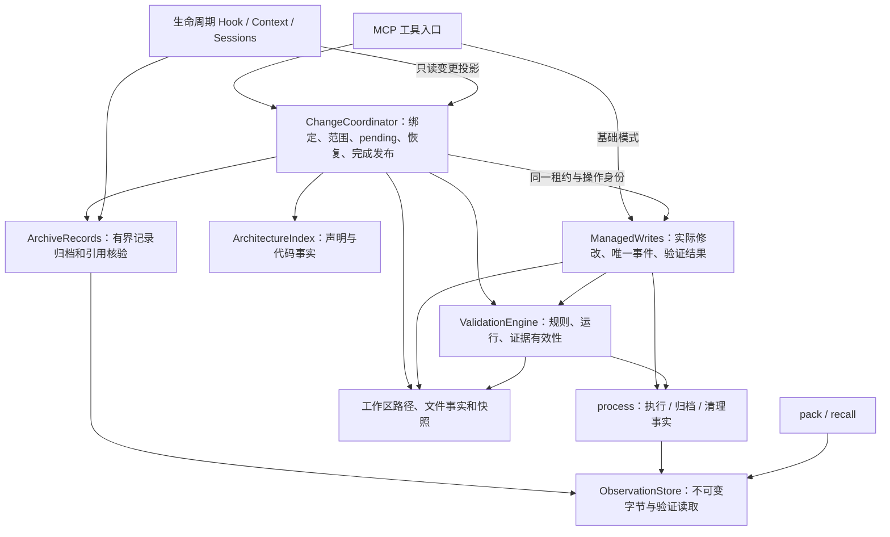

# Codex-SoL 架构改造设计与实施

日期：2026-10-06。状态：**用户确认后，程序批次 A–E 已实施**。最初的方案评审与改造前探针保留在本文；当前结果见 [验收记录](fixtures/architecture-evolution/README.md)。公开工具名称、请求形状、schema_version=1 和版本号保持现行合同。批次 F 的真实宿主与模型效果尚未验收。

依据：引用聊天《评估 codex-sol 插件质量》、当前 `codex/linux-adaptation` 分支的 `f2ed54313f9aa97c1928b3411c1330dfdd3c05f2`、本轮真实文件/进程/STDIO 探针和独立评审。引用聊天审查的是旧提交 `3f6ea68`，不能直接作为当前状态。

本设计接续 [原设计](architecture.md)、[接口合同](contracts.md) 和 [已实现状态](architecture-current.md)，实现归属沿用现有项目文档与数据 owner。

## 1. 推荐方向

保留本地 Node 单服务、现有依赖、MCP/Hook 入口和唯一变更协调器。将文件效果、进程执行、证据读取、变更发布分别放到职责所属位置，使新增入口能够复用同一流程，失败恢复能够解释已知事实。

先修权限与执行事实，再修快照和证据读取；随后解除变更核心对 Context 的反向职责依赖，补操作证据关联；最后补诊断、CI 与效果验收。模块提取随这些实际变化实施。

保留以下行为：

- 默认四工具、Context 六工具、架构十三工具；现有名称、请求字段及公开 `schema_version=1`。
- 一个工作区一条可写变更、完整文件范围、版本绑定、跨进程租约、取消及资源释放。
- 不可变归档、先归档后发布指针、发布前核对输入；失败不自动重放。
- `ChangeCoordinator` 独占任务状态发布；Context 和 Hook 读取投影。产物 accepted、查询 ready、检查 passed 不能单独代表完成。
- JS ESM 静态事实的覆盖边界；LLM 的语义复核与程序证据核验继续区分。

## 2. 改造前基线与缺口

| 项目 | 当前状态 | 对改造的含义 |
| --- | --- | --- |
| 修改、同步验证、原文归档、SHA-256、精确召回 | 已有实质实现和真实文件/进程测试 | 保留基础能力，修共同边界 |
| 查询→登记→写入→复核→累计检查→完成→恢复 | 当前协调器、Context/Hook 和分阶段宿主夹具已实现 | 保留最终发布 owner，补证据关联 |
| Linux Bash、原生 patch、路径与执行器权限 | 新分支已实现，历史 WSL 验收在 `fixtures/linux/` | 旧聊天“只有 Windows Shell”已过期 |
| 被写文件的权限、启动后归档失败的执行事实 | 本轮复现仍失败 | 执行器权限检查不能代替文件保护 |
| 大日志资源成本、验证与返回字节一致 | 本轮复现仍有缺陷 | 将保证放到共享 store 读取边界 |
| 配置诊断、CI、宿主版本兼容 | 有部分宿主证据，缺统一诊断与 CI | 补确定性反例，保留真实环境条件 |
| 模型自主连续任务和 token/费用收益 | 尚无真实模型开关 A/B | 评分器校准不能作为插件收益 |

本轮未重新验收 Desktop GUI、Linux TUI 信任/Esc、Linux 取消桥接、sandbox/ask 或独立普通 Linux 主机。宿主历史证据仍只对应已记录的平台和版本。

## 3. 改造前缺陷与探针证据

本节记录实施前的反例；不能作为改造后的状态。正式回归与实际结果见 [验收记录](fixtures/architecture-evolution/README.md)。F6 后续已加入真实文件系统故障切点与 MCP 恢复验证。

| 编号 | 位置与触发 | 本轮观察 | 最小修正 |
| --- | --- | --- | --- |
| F1 / P1 | `server.mjs:applyChanges`、`workspace.mjs:fileState`；覆盖 Linux 脚本 | 同内容写入 `755→600`，却 `changed_paths=[]`、`validation=null`；异文也变 `600` | 保留权限，统一文件效果与输入指纹 |
| F2 / P1 | `process.mjs:runCapturedCommand`、`managed-command.mjs:34`；启动后归档失败 | marker 已写、退出码 null，摘要仍 `tool_may_have_executed=false` | 执行、归档、清理事实分别保存 |
| F3 / P2 | `recall.mjs:125`、`store.mjs:readVerified`；16 MiB 原文读取五页 | 返回 28,000 B，却加载 83,886,080 B 完整缓冲，另有完整哈希扫描 | 流式验证中收集有界页 |
| F4 / P2 | `validation.mjs:listTree/snapshotInputs`；只监视 `src/**` | 无关 `node_modules/.bin` 链接使快照失败；显式排除后正常 | 编译保守的 watch 遍历计划 |
| F5 / P1 | `store.mjs:openVerified→readVerified`；核验后、读取前改 raw | Windows 探针返回 `modified`，仍附 `original` 的 SHA | 返回字节来自同次已验证的数据流 |
| F6 / P2 | `process.mjs:finally`、`workspace-lock.mjs:setRunner` | 静态确认 idle 持久化异常可覆盖已经完成的进程结果；该故障切点本轮未执行 | 保留 outcome，附加清理错误和恢复阻塞 |

F5 是包装现有方法、控制修改时点的临时归档故障注入，不是外部攻击实测。实施阶段另用真实 fd 关闭、目录冲突、owner rename/unlink 故障覆盖捕获和清理路径。

Linux 四项探针使用 WSL Ubuntu 24.04、Node `22.23.1`，被测文件位于 Linux 临时文件系统；Windows 使用 Node `24.11.0`。六组既有相关测试为 **72 通过、1 跳过、0 失败**；跳过项是 Linux 执行权限缓存专项。此结果说明既有断言未覆盖全部反例，不能宣称问题已修复。

## 4. 目标依赖和状态归属



该图表示实际模块职责与依赖；运行行为由对应测试核验，图本身不构成执行证明。组合入口传入有限依赖。

| 责任 | 实现位置 | 输入输出、调用方和副作用 |
| --- | --- | --- |
| 受管写入 | 新 `src/managed-write.mjs`，沿用 command/patch | server 调用；输入写删/patch、signal、操作身份和可选 lease；输出实际路径、执行事实、验证/错误。产生一次事件，不发布任务完成 |
| 路径与文件替换 | 既有 `src/workspace.mjs` | 保留路径校验；正式文件按既有权限覆盖。私有 JSON 的 `writeAtomicJSON` 仍使用独立的私有权限策略 |
| glob、遍历和输入事实 | 新 `src/workspace-snapshot.mjs` | 移入现有 matcher/排除/快照；validation、协调器、修改边界共享；只读，不启动 runner；旧导出先委托 |
| 有界结构化归档 | 新 `src/records.mjs` | 提取 Context 的 archive/stored/evidence；Context 和协调器共用；核验 workspace/tool/kind/长度/RawRef，消费者校验记录语义；不管理任务状态 |
| 入口组装 | 新 `src/runtime.mjs`，保持薄 factory | MCP 与 Hook 共享已验证配置、store 和核心依赖的装配；显式参数，不启动 transport、不读隐藏环境。按入口需求延迟创建 Context/变更能力 |
| 变更事务 | 既有 `src/architecture/change.mjs` | 保留 read/publish/run/refresh/inspectLocked/review/complete；依赖 records、validator、index、最小配置视图，不依赖整个 ContextEngine |
| 职责上下文 | 既有 context/session | 选择材料、校验产物、管理会话引用；消费变更投影；未绑定 Context 不装配另一任务或新增验证配置要求 |
| 验证字节读取 | 既有 `src/store.mjs` | 新内部有界读取接口；recall、pack、记录/验证消费方共用；旧小型 readVerified 保留兼容委托 |
| 宿主与诊断 | 既有 host-cancellation/plugin-launcher | 小边界解码 metadata、只读 thread、rollout；launcher 增加只读配置诊断；不建立另一份配置和状态 |

现在保留协调器的集中编排。不拆独立 CompletionService、StateMachine 或第二套任务 Repository。只有复核规则出现独立变化时，才提取材料组装/覆盖核验函数；辅助函数没有发布权限，也不接收整个协调器来修改状态。

## 5. 必须落实的内部合同

### 5.1 文件效果与输入事实

正式文件覆盖先读取已验证路径的原始事实。同文不替换；异文在临时文件完成写入后恢复原普通 POSIX 权限再发布。新文件维持现有明确创建策略。特殊权限位、所有者和 ACL 不等于普通 mode 保证；不支持的保护要求在发布前明确处理，不能宣称已经保留。

文件事实分开记录 missing/file、内容 SHA、平台适用的普通权限，再计算带策略版本的组合输入指纹。内容 SHA 的含义仍是原文内容；时间戳仅辅助检查读取中漂移。

fileState、ChangeEvent digest、规则输入、observed snapshot、差异比较和 review/完成新鲜度使用同一事实算法。纯 chmod 必须可见并使相关证据失效。单文件读取检查稳定性，操作前后复核观察快照，检测到漂移即失败；不承诺外部编辑并发下的跨文件原子快照。

watch 仅在证明目录及后代不可能命中时剪枝。`src/**/*.mjs` 必须进入 src；`**/config.json` 不按固定根误剪枝。generated、隐藏文件、大小写、删除种子、取消和相关 symlink 拒绝沿用现有语义。

协调器检测范围外修改的 `**/*` 仍覆盖全工作区；窄 watch 优化只作用于相应规则。Node/Python 示例复用 generated 配置，不默认从验证中排除用户代码。

### 5.2 执行、归档与清理

内部 outcome 分别记录启动 `not_started/started/unknown`、退出/中断、已提交 refs、归档错误、清理错误。仅明确未启动才映射 may-have-executed=false；未知和已启动映射 true，不从 exit_code 推断副作用。

准备启动的持久回调之后、spawn 之前再检查取消。启动后归档或 idle 更新失败仍保存已知执行、退出和输出事实，顶层失败；finally 的清理错误不得抹掉结果。资源释放和锁恢复由 lease owner 负责。

旧 CheckResult、RawRef、公开回执都是严格 shape；新增内部字段后，由 ValidationEngine 显式投影到旧公开形状，第一批不直接向旧对象添加启动字段。归档失败不发假 handle，不为了补日志重跑命令，不自动删除合同要求保留的失败临时归档。

### 5.3 操作身份与恢复

绑定模式由协调器创建一次操作上下文，根 operation_id 与外层 call_id 统一，传入写入、capture、ChangeEvent。子检查保留独立 ID，通过原有事件/父操作链关联。基础模式由受管操作边界创建同类上下文。

顺序：取得租约 → 核验绑定/全部目标 → 发布 pending → 执行一次 → 收集实际变化/检查/错误 → 归档 outcome → 发布 outcome 引用 → 发布最终变更版本。部分成功也是结果。

在现有 `.codex/sol/architecture/` 下原子发布 `operations/<operation_id>.json`，只保存有界身份和 outcome RawRef。协调器负责核验 workspace、change、operation 与归档；该指针用于定位证据，不能推进任务状态。仅在最终 settled record 添加 operation_ref 无法覆盖最终发布失败的窗口。

恢复依然以 active-change 指针为任务来源，沿 pending.operation_id 找已发布 outcome，结合实际工作区判断 interrupted/unknown。outcome 尚未发布、引用缺失或磁盘不可用就保留未知；不从文件反推历史执行结果。status 不重放操作/检查，显式 resume 才恢复可写。

idle 持久化失败保留 outcome、附恢复阻塞，不删除可能仍在使用的活 owner。实施时验证持原租约身份且确认子进程结束的安全收尾，以及现有死 owner 的重启恢复；无证明时保持阻塞，不能用解锁掩盖未知副作用。

### 5.4 返回字节来自同一次核验

新内部 `withVerifiedRead` 类边界检查 handle、普通文件和 workspace；流式计算完整 raw/index SHA，同时私有收集预算内的候选字节，全部核验完成才返回。fd、取消与关闭在该边界结束；消费者不再组合“核验后再读取”的裸句柄。

- bytes：完整扫描只保存目标页，保留 end-exclusive、base64 与 8 KiB 响应合同。
- lines：使用 lines.idx 时，定位偏移来自同次核验的索引字节，并须与 raw 实际 LF 位置一致；否则以 raw 流的 LF 计数定位。仅检查范围、单调性和索引 SHA 不足以证明行号正确。整档 fatal UTF-8 流式解码，保留 CRLF、超长行、跨块字符。
- keyword：有界寻找当前/下一窗口，保留跨块 literal、上下文行、窗口合并。第二次扫描仍绑定第一次固定的 raw/index SHA、长度和元数据，变化即失败，不采用新 meta 重新解释旧窗口；返回页来自该次成功验证的数据流，不保存全部窗口或文本。
- pack、Context、review、验证回执读取采用同一保证，避免只修 recall 而留下兄弟调用方的窗口。

第一阶段无整档 Buffer，内存取决于扫描块、页及必要搜索状态。**bytes/lines 每页仍 O(N)，keyword 最坏两次扫描，P 页仍 O(P×N) I/O。** 这解决内存和读取真实性，尚未消除重复全档验证。

不采纳仅凭 handle/size/mtime/ctime 缓存“verified”。若大日志独立实测仍超预算，另开分块证明/有界会话设计，明确完整核验合同的变化、可信证明根、cursor 绑定、漂移/重启失效、旧档回退。当前不改归档格式，不削弱完成证据核验。

### 5.5 Context 与基础证据分离

ArchiveRecords 只归档有界记录、按预期类型读取、核验引用，不解析职责路由和保存第二份任务状态。Context 原方法先薄委托；协调器从组合入口获得 records、validator 和最小配置读取器。

配置仍由原项目文件和一个解析 owner 提供：Context 消费职责字段，协调器消费摘要与 architecture 路径；没有复制配置。摘要变化仍使旧绑定失效。

薄 runtime factory 只统一当前 server/Hook 已重复的装配，保留 createSolServer 的外部入口以及 Hook 对绑定会话的按需语义；不把全部模式强行装配为十三工具。CommonJS bootstrap 继续只依赖标准库做路径引导。只读 check-config 不调用会创建 store 的 runtime factory。

复核准则的实际变化由协调器维护明确的 review_policy_id，纳入 prepare basis、submit、complete 和只读 freshness 核验。旧 review 缺标记或标记不同则重新 prepare/submit，历史仍可召回。只在准则实质改变时更新，不对整个插件源码做语义版本哈希；该标记也不证明模型判断正确。仅准则变化使旧复核失效的回归已在 tests/change-migration.test.mjs 执行。

### 5.6 宿主兼容与只读诊断

现有 host 文件界定 metadata 解码、只读 thread 定位、rollout 解码。版本只标记实测环境；形态核验及目标 turn 的显式中断事件决定行为。已配置桥接证据不足仍 HOST_STATE_ERROR，不能静默关闭后宣称支持取消。

launcher 已增加 `check-config` 模式，复用 resolvePluginProject、实际规则配置校验、Context schema、路径和执行权限检查。报告有限的缺字段、配置/launcher 不一致、不可执行等原因；不创建 store、不改指针、不执行项目命令、不调用模型、不安装插件或调整信任。配置为 valid 仅表示覆盖字段通过：架构声明是 path_only，宿主兼容是 not_checked；架构内容与宿主握手仍由自己的入口验证。

本地配置诊断不启动宿主；另有显式只读兼容探针才测试实际握手。内部诊断用 stage/cause/关联 ID，保留公开错误码，不输出完整宿主 stderr、秘密环境值或私有堆栈。

## 6. 兼容与迁移

1. 提取模块先保留行为和公开形状；过渡委托核对所有真实调用方后移除，不长期维护两套算法。
2. mode 和 outcome 属于内部持久契约变化。集中定义带指纹策略标记的新严格 shape，以及旧 shape 的只读解析。先按原始归档和原 body 验证旧 hash，再作内存解释；缺 mode 为未知，默认值不能参与历史 hash。
3. 旧内容证据不取得新权限敏感的缓存/完成资格。Context/Hook 的 inspectLocked 只投影失效且不发布；显式 sol_change_status 由唯一协调器在同一租约内核验旧 basis、读取新事实、归档带新策略的 dirty/interrupted 记录、previous_handle 串接旧 raw，再原子发布刷新绑定。该步骤清当前缓存/review/completion资格，不修改旧归档、不运行检查，不把格式变化伪报成所有文件被修改。旧 pending 保持 interrupted/unknown，resume 独立且不重放；显式准备、复核、验证才生成新的有效证据。
4. 新旧解析分支归数据 owner；公开 sha256 不重新解释为混合指纹，工具请求与状态枚举不随提取改变。
5. 新 reader 能读旧档，不等于旧二进制能读新内部字段。回滚点在写新格式之前；之后保留新 reader 和全部数据，不把代码回退当作格式回退。
6. 同步现有 architecture.example 的稳定 UID、source、导出和使用方；只登记稳定共享能力。检查 package-plugin 的显式白名单、CommonJS bootstrap 和装载测试，避免安装包漏新增文件。

## 7. 独立评审裁决

角色为架构与契约、故障反例、实现验证、可维护性。主 agent 归并共同根因并统一动态验证。关键取舍如下。

| 建议 | 裁决 | 理由 |
| --- | --- | --- |
| 保留协调器，抽归档/受管写入/输入事实 | 采纳 | 新入口与恢复有真实消费者，事务仍只有一个 owner |
| 独立 CompletionService、通用状态机、事件总线、第二存储服务 | 不采纳 | 当前没有独立替换需求，会扩大同一事务的数据/租约传递 |
| 旧 CheckResult 直接加启动字段 | 第一批不采纳 | 旧严格消费者可能拒绝，先内部 outcome + 显式投影 |
| range read + 每页完整 SHA | 采纳并收紧边界 | 单纯 hash 后再 read 仍有窗口，候选页来自同次核验流 |
| 句柄/mtime 缓存或局部哈希替代完整验证 | 不采纳 | 不等价于每次打开完整核验，不静默降低保证 |
| 按 ID 保存有界 outcome 引用 | 采纳 | 统一 ID 或 settled 可选字段不足以覆盖最终发布失败 |
| 薄 runtime factory 与复核准则标记 | 采纳 | 入口共享装配有真实消费者；准则变化应使旧 review 失效，不新增状态 owner |
| 配置诊断、宿主形态反例、两平台 CI | 采纳 | 对实际接入失败有用，须保留真实环境条件 |
| 以测试数、指导下闭环、评分器校准宣布模型收益 | 不采纳 | 未测自主行为和实际成本 |

## 8. 分批实施与验收

先留下能发现反例的回归，再改 owner，审阅 diff，运行最小相关检查。下表保留已确认的验收要求；程序 A–E 已实施，F 未执行。C 已测缓冲分配上界、完整读取量和 Linux 进程生命周期峰值 RSS；后者包含导入、夹具构造与探针开销，没有旧版对照或因果收益声明。远端 CI 与最低版本实测分别记录，不能由 workflow 文件推断通过。

| 批次 | 修改范围/依赖 | 完成条件 |
| --- | --- | --- |
| A 写入和执行事实 | workspace/server/managed-write/process/managed-command；MCP、Linux、capture/failure 测试 | 755/644 同文异文保留权限；启动前后归档失败映射正确；部分写入可见；取消、后代终止、锁清理和后续请求保留 |
| B 输入事实和剪枝 | workspace-snapshot/validation/change；依赖 A，含新旧指纹 | mode-only 使证据失效；窄 watch 不遍历无关树；相关 symlink 仍拒绝；增删/配置变化检出；全工作区越界核对保留；旧证据仅历史有效 |
| C 严格有界读取 | store/recall/pack/记录消费方；无新归档格式依赖 | 无全长 Buffer；同次验证字节；旧 UTF-8/CRLF/keyword/cursor 精度；篡改/取消/fd 清理；量化读取量和峰值内存，承认保留的全扫成本 |
| D 依赖和恢复 | runtime/records/context/change/session；依赖 outcome 和输入契约 | 无 ContextEngine 也能核对变更；未绑定 Context 无新增依赖；统一 ID；最终发布失败能恢复已发布 outcome；未知不伪造、不重放；仅准则变化也使旧 review 失效；协调器独占完成发布 |
| E 接入与 CI | host/plugin-launcher/package-plugin、schema/示例/测试、拟新增 workflow | 只读安全诊断；协议反例可定位；两平台真实 native 条件；4/6/13 注册、旧配置/档案、打包与架构登记一致 |
| F 宿主与效果 | 沿用 fixtures/host、fixtures/linux、benchmarks/self-eval；程序批次通过后 | 指定平台版本的真实信任、取消、恢复、装载；固定任务模型 A/B 保留失败、重试、人工介入和实际成本 |

对应的最小验证入口（新 owner 回归另列于验收记录）：

```text
A: node scripts/test-runner.mjs tests/mcp.test.mjs tests/linux.test.mjs tests/capture-failure.test.mjs tests/validation-failure.test.mjs tests/native-integration.test.mjs tests/failure-protocol.test.mjs tests/workspace-lock.test.mjs
B: node scripts/test-runner.mjs tests/validation.test.mjs tests/validation-reuse.test.mjs tests/validation-failure.test.mjs tests/change.test.mjs tests/closure.test.mjs
C: node scripts/test-runner.mjs tests/store-recall.test.mjs tests/pack.test.mjs tests/capture-failure.test.mjs tests/context.test.mjs tests/closure.test.mjs
D: node scripts/test-runner.mjs tests/change.test.mjs tests/closure.test.mjs tests/context-change.test.mjs tests/context-change-hook.test.mjs tests/change-hooks.test.mjs
E: node scripts/test-runner.mjs tests/host-cancellation.test.mjs tests/plugin-project.test.mjs tests/plugin-runtime.test.mjs tests/plugin-package.test.mjs
集成: npm run check
范围: git diff --check
```

新 owner 专属回归加入对应批次。独立 lint/format/typecheck 当前未配置，不声明已通过。

迁移专门覆盖真实旧 completed/旧 pending、未知指纹标记、仅复核准则变化、outcome 归档/引用发布/settled 发布失败、status 升格归档/rename 失败：旧 handle、字节和历史 hash 不变；未成功发布不取得新资格；状态刷新返回正确绑定，runner 计数不增加。

CI 不能无条件复制本机环境：Windows 真 patch 需要已有原生 Codex；Linux 缺路径会跳过。明确配置真实 native runner，或分 portable/native job 并准确报告未跑项；不以假引擎和削弱断言补绿色结果。按声明最低 Node 与实际当前版本验证，保留并发 4。

模型 A/B 固定任务、基线、规则、运行时，复用现有 prepare/grade/compare。记录成功、适用复用、失败/重试、人工介入、耗时、实际 token/费用、插件 I/O；未测值用 null/not_measured，不按摘要字数估价或只挑已完成任务。

## 9. 本轮交付与后续边界

本轮先完成问题核对、责任设计和独立评审，再按用户授权实施程序 A–E，补反例、复核实际 diff 并运行完整 Windows/Linux 检查与便携 CI 入口。最终计数、输入 SHA、索引、审计与未跑项见 [验收记录](fixtures/architecture-evolution/README.md)。未重新验收 Desktop GUI、Linux TUI 信任/Esc、Linux 宿主取消桥接或模型 A/B。

设计阶段六组检查为 72 通过、1 跳过；Linux 四项探针及 Windows 字节一致性探针用于建立缺陷基线。改造后的回归已转正到 tests。原始设计探针和实施日志分别在忽略目录 `slop/architecture-review-20261006/` 与 `slop/architecture-implementation-20261006/`，不随 Git/插件包交付；正式代码不依赖这些目录。

分块证明/会话的高性能策略、项目许可证、公开发布时默认分支和版本处理单独决策，不阻塞 A–E 的兼容改造。本方案不替用户选许可证或执行发布。
