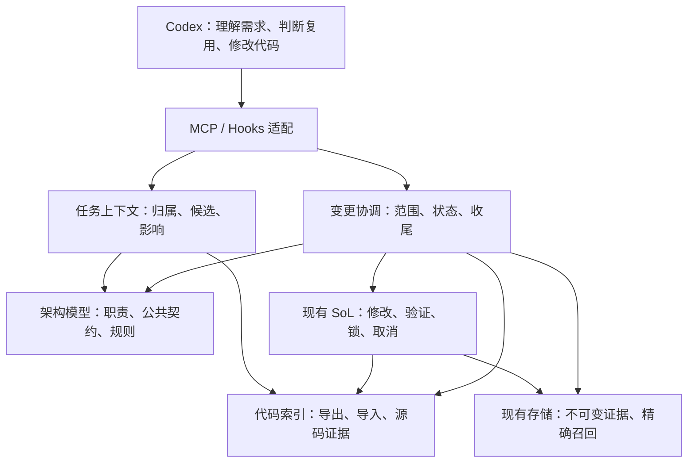

# 架构实施合同：归属、复用与影响证据

2026-10-06 已按 [架构改造设计](architecture-evolution.md) 实现文件与执行事实、共享输入快照、流式验证读取、证据与恢复职责、只读配置诊断及 CI。现行内部合同见 [contracts.md §16](contracts.md#16-架构演进的内部合同2026-10-06)，程序验收与未验证范围见 [本轮记录](fixtures/architecture-evolution/README.md)。真实宿主与模型效果仍单独验收。

日期：2026-10-04。状态：M-000 写前 Context、M-001 查询索引及现有生命周期 Hooks 已实现；M-002 已接通登记、绑定写入、维护建议、版本绑定复核、累计检查及完成发布，最新边界见 §4.12。博客仅为 Hook 测试夹具，不列产品计划。本文承接 [README](README.md) 和 [Notion 开工单](https://app.notion.com/p/3e831ddb72338111ada4dffbdd87713b) 的已确认方向；运行行为以 [contracts.md](contracts.md) 为准。

阅读顺序：目标 → 职责与数据 → 变更闭环 → 实施顺序 → 验收。本文锁定职责和行为，工具名称、文件拆分与非必要字段由实施时决定。

当前代码职责树、已实现入口和测试边界单独列于 [architecture-current.md](architecture-current.md)；本文继续作为既有实施合同，不建立新的规划体系。

2026-10-04 根据软件工程原始论文、MIT 契约课程和 SWEBOK 相关章节补充并实现 §5.1–5.4，依据和选择边界见 [closure-research.md](closure-research.md)。§4.11 保留首片历史，当前交付见 §4.12。

## 1. 目标与架构决策

| ID | 目标 | 首轮可观察结果 |
| --- | --- | --- |
| REQ-001 | 需求变化有明确归属 | 每次受管变更关联需求来源、目标模块和验收条件；发现范围外改动时给出具体路径。 |
| REQ-002 | 已有能力容易发现 | 新增公共能力前能查询已有候选，读到契约、实现位置和使用方；记录复用、扩展或新增的理由。 |
| REQ-003 | 架构调整有影响证据 | 修改共享能力后列出已识别使用方、未覆盖关系和实际检查结果；旧证据不能用于新快照。 |
| REQ-004 | 降低完整任务的成本 | 同任务对比 V0.1，计入工具、上下文、索引维护、召回和重试成本，保留正确性结果。 |
| REQ-005 | 职责输入、模型输出和下游交接明确 | 每个执行职责声明必需输入、模型产物要求和消费者；缺少、无效或过期产物不能被当成已满足前置条件。 |

以下为实施决策；其中首轮单变更和静态分析粒度是本轮采用的最小技术默认值。

- **ADR-001｜本地模块化服务**：一个插件包通过本地 STDIO MCP 提供能力，Hooks 为宿主适配层。继续使用 Node.js，不增加云服务、数据库服务或消息队列；各职责可独立测试，不分别部署。
- **ADR-002｜树、图、索引分工**：模块包含关系采用多叉树，依赖采用有向图，公共能力和反向使用方采用派生索引。稳定模块 UID 表示身份，名称和路径可变；不用线索二叉树承载跨模块关系。
- **ADR-003｜声明与事实分别保存**：优先复用固定版本 Normify engine 管理架构声明和规则；代码事实由薄分析适配器提供。索引更新、哈希刷新、模型复核和代码验证分别记录，不能相互替代。
- **ADR-004｜复用 SoL 执行与证据链**：沿用工作区锁、实际变化检测、ValidationEngine、ObservationStore、pack/recall 和取消链路。架构层不另建 runner，不自动安装依赖或修复代码。
- **ADR-005｜先收敛受管闭环**：架构模式显式启用；关闭时保持现有四个 MCP 工具兼容。首轮一个工作区只允许一个可写变更，调用必须明确绑定该变更，不能凭“当前聊天”猜归属。首个插件验证无新增 Skill、无新增 AGENTS.md。
- **ADR-006｜Context 先于新增 Hook**：先实现按任务选择、组装、核对新鲜度与恢复的 Context 核心，通过只读工具验证；再接入架构数据源和生命周期注入。Hook 消费该核心的输出，不各自检索、摘要或维护另一份任务状态。2026-10-03 用户将优先级从 Hook 调整到 Context；既有 Hook 保留。

## 2. 四个新增职责

| 职责 / 建议代码位置 | 拥有的数据与行为 | 公共输入 → 输出 |
| --- | --- | --- |
| 架构模型 `src/architecture/model.mjs` | 模块、公共契约、声明依赖、policy；Normify 适配和模型诊断 | 声明及版本 → 模块树、能力索引、结构/规则诊断；更新需核对预期版本 |
| 代码索引 `src/architecture/facts.mjs` | 源码事实、内容指纹、分析覆盖；按实际变化失效和重建 | 工作区输入快照 → 导出/导入关系、位置、覆盖说明；读取失败不返回伪空索引 |
| 任务上下文 `src/architecture/context.mjs` | 归属查询、候选排序、影响查询、有界上下文 | 任务文本、目标路径/模块、当前版本 → 相关契约、候选、使用方、诊断和原文引用 |
| 变更协调 `src/architecture/change.mjs` | 需求引用、范围、复用决策、复核记录、运行状态、完成证据 | 变更意图及实际事件 → 状态、允许的下一步、未解决项和完成回执 |

这些位置表达责任边界，不要求每项再拆成框架或大量类。`server.mjs` 与 `native-hook.mjs` 只承担注册、宿主输入转换和调用协调；规则与状态迁移不能各复制一份。

工作区根由本地配置绑定，复用现有路径与真实路径校验；不向模型暴露任意 `repoRoot` / `dir`。受管修改期间协调器使用同一工作区锁租约，不能嵌套重新获取锁。

## 3. 数据及事实来源

| ID / 实体 | 最小内容 | 唯一来源 |
| --- | --- | --- |
| ENT-001 架构声明 | UID、职责、parent、source、公共契约、出向依赖、policy、planned / active / deprecated | Normify 声明文件；children、反向依赖和能力索引派生 |
| ENT-002 代码事实 | 文件和符号位置、导出、可解析导入、内容指纹、分析器版本、未覆盖说明 | 当前源码与项目解析配置；索引可删除重建 |
| ENT-003 变更记录 | 需求引用、模块/路径范围、验收条件、复用决策、当前版本、复核与证据引用 | 变更协调；已有需求文档只保存引用 |
| ENT-004 完成证据 | 工作区/变更身份、架构版本、源码与配置快照、检查结果、原文 handle | 现有 SoL 回执和归档，加架构核对记录 |

**归属**：首轮按文件登记叶模块，父模块聚合子模块。一个文件出现多个叶模块归属时返回冲突，不悄悄选择；未登记路径返回“未归属”，由模型扩展现有模块或登记 planned 模块。普通私有函数只进入代码事实；跨模块维护的公共能力才登记契约。

**契约**：复用现有类型、注释和测试，登记可定位的引用及必要摘要：输入输出、错误、副作用、取消/资源责任、兼容性和使用例。先沿用 Normify 正文表达，不预建另一套接口 Schema。声明依赖与检测到的导入关系保留各自来源。

**首轮分析粒度**：当前项目的 JavaScript ES module 导出与静态导入、文件到模块的映射；使用经过验证的现成语法解析器适配，不用正则伪造调用图。动态 import、动态注册和间接调用列为未覆盖，模型复核相应使用方。语法错误、无法读取与分析失败给出诊断；未覆盖不能表述成“无使用方”。解析器选型在 M-001 按本项目夹具验证，当前不安装依赖。

**存储**：版本管理的声明、policy 与必要设计变更记录放在 `.codex/architecture/normify-project/`；目录名兼容上游 `normify-*` 约束。生成索引、发布指针与临时运行状态放在 `.codex/sol/architecture/`；原始证据留在现有 SoL 存储。上游生成产物由适配层隔离，不作为新的事实来源。跨 checkout 的证据缺失明确显示不可用。

**新鲜度**：绑定工作区身份、架构声明/policy 内容、源码/配置/测试输入和分析器版本，包含未提交文件及删除。Git HEAD 只作说明。文件移动时 UID 保留、source 更新；不能把同路径的新内容当成旧证据。查询先核对版本，变动的文件失效后再分析；启动/恢复及收尾检查完整输入，捕获受管入口之外的变化。

**发布**：复用工作区跨进程锁；索引构建成功后发布完整 generation 的单个指针，查询只能读到完整旧版本或完整新版本。声明更新采用版本校验；外部修改导致冲突时重读并诊断，禁止以旧内存回滚覆盖他人修改。Normify 上游的 refresh/verified 不直接写成 SoL 完成状态。

## 4. 模型使用与变更闭环

沿用 README 的 brief、lookup、change_open、change_close 接口方向；具体工具名称不是本合同的重点。准备结果可携带查询证据供登记复用，避免重复扫描和强制多轮问答。架构声明更新属于模型职责，也必须有受校验的更新入口；更新后保留诊断和版本，不通过工具注册层直接改内存。

| ID / 操作 | 输入与结果 | 关键责任 |
| --- | --- | --- |
| IF-001 定位/查询 | 任务、目标 → 模块、候选、契约、使用方、查询版本及覆盖 | 只读；新公共能力登记须引用有效候选查询和选择理由；无命中仅代表当前查询范围 |
| IF-002 登记/调整 | 需求来源、范围、验收、复用决策、预期版本 → 变更身份与诊断 | 未归属先解决；影响扩大时显式调整范围；声明变更检查 UID/引用/规则 |
| IF-003 受管修改 | 既有修改参数和变更绑定 → 实际变化、状态和 SoL 回执 | 写前检查可确认的目标范围；失败但部分写入仍失效；一个实际操作只产生一个事件 |
| IF-004 核对/收尾 | 复核记录、当前输入、验收证据 → 未解决项或完成回执 | 核对声明与可分析事实、policy、影响面和代码检查；全部必需证据有效才完成 |

示例：“给上传功能加重试且取消时停止重试” → 查询上传模块和现有重试/取消契约 → 登记上传模块及实际受影响共享能力 → 受管修改 → 列出共享能力使用方 → 更新声明或记录“契约保持不变”的复核依据 → 检查通过后收尾。不能仅因重试函数名字相似就自动合并。

**上下文**：单份架构 context packet 的完整序列化输出上限 4096 UTF-8 字节，包含版本、能力状态、关键阻塞项、允许的下一步和原文引用；契约与使用方超预算时列出遗漏量并按需召回。相同版本去重，变化后提供差量。不静默截掉阻塞项，不每轮注入完整树。现有修改/读取/recall 输出预算保持原合同。

**责任区分**：程序判定范围、引用完整性、规则、新鲜度和必需证据；模型判定需求理解、候选是否合适、接口语义与兼容性。复核记录证明“已针对该版本复核”，不能冒充机器证明语义完全一致。

### 4.1 Context 首轮合同

Context 的目标是让模型读到完成当前任务所需的有效信息。现有 ObservationPack / recall 已负责工具输出的有界呈现与原文召回；新增核心负责任务信息的选择、组装、失效与恢复。

**IF-005｜构建任务上下文**：输入当前执行职责、任务目标、明确的目标路径/模块及已有上下文版本；读取对应声明、代码事实、变更状态与 SoL 证据，返回 **ENT-005 任务上下文包**，包含本职责所需材料、模型输出要求和下游交接说明。职责要求来自可定位的职责契约。该接口只读，不创建变更、不执行检查、不更新 completed 状态。M-000 可先从现有项目文档、目标文件与 SoL 证据接入；未接入的架构索引和变更状态明确列为能力缺失，不能编造候选或进度。

ENT-005 只组装五类信息：

| 内容 | 来源与用途 |
| --- | --- |
| 当前目标与验收 | 当前请求及已有需求引用；保留明确约束，模型解释与原文可区分 |
| 当前状态与未解决项 | 变更协调和有效回执；告诉模型做到哪里、还缺什么 |
| 相关职责、契约和规则 | 项目声明与可定位文档；约束本次修改 |
| 复用候选与影响范围 | 能力查询和代码事实；提供位置、来源及覆盖边界 |
| 证据与展开入口 | SoL handle、版本及源码引用；支撑检查和按需读取 |

处理顺序为：**定位信息来源 → 检查版本 → 按任务筛选 → 按预算组装 → 返回摘要与展开入口**。目标文件/模块和当前未解决项优先；检索无命中说明查询范围，信息不足时给出需要进一步查询的入口。首轮复用明确路径、模块关系和可解释的文本匹配，不要求 embedding 或额外 LLM 摘要服务。

ENT-005 沿用 4096 UTF-8 字节完整序列化预算。优先保留任务约束、版本、能力缺失与关键阻塞项；其余信息省略时返回数量和可召回引用。原文不因打包被删除；来源缺失、内容冲突和过期分别显示，不被摘要变成确定事实。

恢复时从事实来源重建：任务目标、变更状态、有效证据、未解决项和下一步。去重以当前会话已经收到的版本为依据；新会话、compact 后或无法确认已交付版本时返回完整有界包，不能因为服务缓存命中过而省略模型已丢失的信息。差量标记所依赖的基础版本，缺少基础版本时回退到完整包。

Hooks 与 MCP 共用 IF-005。Context 核心管理的是所提供的信息及其版本；现有聊天历史的删除、重写或宿主自动 compact 不属于该接口能力。

### 4.2 职责输入与产物交接

用户已明确 REQ-005；论文与项目依据见 [Context 调研](context-research.md)。职责可以是同一模型的不同阶段或独立 agent 任务。下述机制作为首轮实施建议，不预设必须使用多个模型或完整组织化流水线。

职责契约定义目标、必需/可选输入、允许操作、期望输出和消费者映射。IF-005 先按职责选择所需材料，再按预算呈现；预算不足时提供展开入口，不能只靠裁剪固定文档代替职责设计。

**IF-006｜提交职责产物**：接收模型输出及任务/职责身份、所用上下文版本和证据引用，执行结构、关联与新鲜度校验；通过后保存原文和产物版本，供指定消费者读取。无效提交返回缺失或冲突诊断，不伪造字段补齐。有效记录可以包含执行失败或未解决项，交给修复职责；不能因此记成任务完成。

上下文输入与职责产物分别建模。字段校验复用现有 Zod/Ajv，原文和证据复用 store/recall；产物接受与流程状态归变更协调器，Context 按消费者投影组装下游输入，不维护第二份任务事实。结构校验不保证语义正确，测试状态来自 ValidationEngine，不能由模型自述覆盖。

首轮用“定位与方案 → 实现 → 核对”作验证样例，按任务允许跳过不需要的阶段。下游拿到必需结论、约束、原文引用及未解决项；失败证据保留，过期材料标为过期。两段模型文本自动串联不算已校验交接。

同一聊天按职责追加信息不清除历史；严格隔离另需宿主独立上下文和交接能力的实际验收。首轮只承诺职责所需材料与输出接口，不宣称插件可删除任意已有聊天内容。

### 4.3 官方能力边界与 M-000 开工范围

2026-10-03 核对官方文档：[MCP](https://learn.chatgpt.com/docs/extend/mcp) 提供工具与上下文入口；[Hooks](https://learn.chatgpt.com/docs/hooks) 的 `additionalContext` 可追加上下文，未提供通用的已有消息替换接口；[App Server](https://learn.chatgpt.com/docs/app-server) 的 `thread/start` 可创建新线程，`thread/fork` 复制历史，`thread/inject_items` 追加消息。由此选择先做职责材料与交接，独立线程编排后续单独验收。同一个模型可承担所有职责；M-000 不增加模型服务或 API 密钥。

首个可运行切片是 **定位与方案上下文 → 模型方案产物 → 实现上下文**，交接发生在写代码之前。先证明职责选择和产物映射可用；实现后的证据失效、源码变化关联与任务收尾在 M-002 接入，不能靠拒绝所有来源变化代替该闭环。

| 入口 / 责任 | 最小输入 → 输出 |
| --- | --- |
| IF-005 / `sol_context_prepare`（拟实现） | 任务身份与目标、职责、目标路径、可选上游产物引用 → 本职责输入、输出要求、消费者映射、来源版本、诊断及召回引用 |
| IF-006 / `sol_context_submit`（拟实现） | 准备结果引用、任务/职责身份、模型产物与证据引用 → 已接受产物引用或具体校验诊断；接受不表示任务完成 |

职责契约由本地显式配置提供：目标、必需/可选来源、输出结构、消费者及字段映射。首轮仅配置定位与方案、实现两个职责，核对职责随后接入；不预建工作流 DSL、自动角色路由或另一套记忆库。职责中的允许操作是模型指引，后端实际权限仍由现有受管入口执行。

实现复用 `src/architecture/context.mjs` 的职责边界、Zod/Ajv、工作区路径校验和 ObservationStore / recall；`server.mjs` 只注册两个入口。Context 显式启用，未启用时仍只有既有四个 MCP 工具。准备与提交可归档不可变材料，但不修改源码、不运行检查、不写任务完成状态；原文、版本和交接引用保存于现有 SoL 存储。

首轮验收：两个职责获得各自所需材料；合法方案按配置字段映射进入实现上下文，额外探索文本不自动转交；缺字段、错误任务/消费者、无效引用或写前来源过期均返回诊断；完整包不超过 4096 UTF-8 字节且能召回原文；服务重启后引用仍可用，无已交付基础版本时重建完整包；关闭 Context 后原有 MCP 检查保持兼容。测试使用真实 STDIO 调用和临时工作区，不把结构检查通过当作模型方案正确或任务完成。

本节是开工范围；写前交接切片的实际实现与测试见 §4.5，宿主实测尚未开展。完整 M-000 的架构/任务状态来源及 AC-009–011 后续适用检查仍需逐项接入，不能用首个切片替代全部里程碑。

### 4.4 Hook、MCP、Skill 的职责与注入位置

2026-10-03 用户要求在 Context 实现前明确三个入口的分工和模型动作。采用 **Hook 管时机与门禁，MCP 管当前材料与确定性操作，Skill 按需提供工作方法**。三者调用或引用同一职责契约，不各自保存任务状态、输出 Schema 或检索规则。本节明确接入设计，不代表已安装、启用或通过宿主验收。

| 入口 | 进入模型上下文的位置 / 时机 | 提供的内容 | 模型随后执行的动作 |
| --- | --- | --- | --- |
| MCP server `instructions` | 服务器初始化后，作为跨工具使用说明 | 何时 prepare、如何展开材料、何时 submit、如何处理诊断；前 512 字符自足 | 为具体任务选择职责与目标，调用 IF-005；不靠 Skill 才发现核心工具 |
| MCP 工具描述与参数 Schema | 宿主展示可用工具时；实际发现方式以宿主为准 | 单工具用途、输入、输出、副作用和失败语义 | 选择正确工具并提供参数；不把工具可见当成已取得项目事实 |
| MCP 调用结果 | `sol_context_prepare` / `submit` / `recall` 返回时，作为工具结果 | 本职责目标、所需材料、来源版本、输出要求、交接映射、诊断与引用 | 阅读材料，按需召回，作语义判断，提交符合要求的产物；按诊断修正 |
| Hook `additionalContext` / 拒绝反馈 | 对应生命周期事件，宿主追加上下文或反馈 | 启用状态、恢复材料、版本变化、阻塞原因和可操作入口 | 恢复本职责或处理明确缺口；被拒绝后修正依据和范围再调用 |
| 可选 Skill 的名称 / 描述 | 宿主技能发现列表中 | 适用任务及边界 | 用户显式指定或任务匹配时读取 Skill 正文 |
| 可选 Skill 正文 | 决定采用该 Skill 后按需读取 | 如何判断职责、评估复用、解释方案和兼容风险；指向 MCP 的材料与产物要求 | 用该方法执行当前职责，仍通过 MCP 获取事实、提交产物 |

官方依据：[MCP server instructions](https://learn.chatgpt.com/docs/extend/mcp)、[Hook 各事件的输入输出](https://learn.chatgpt.com/docs/hooks)、[Skill 渐进加载与显式/隐式调用](https://developers.openai.com/codex/skills)。Skill 正文加载是宿主/模型行为，Hook 不自动把每个职责 Skill 全量塞入上下文；第一轮仍沿用 ADR-005 无新增 Skill 的验证方式，后续可增加一个聚焦此闭环的 Skill，无需每个职责各建一份。

#### Hook 注入时点

以下是 M-003 的接入分工；M-000 通过模型主动调用 MCP 验证，不因此提前新增 Hooks。

| 事件 | 传入什么 / 后端做什么 | 对模型的要求 |
| --- | --- | --- |
| `SessionStart`，含 startup / resume / clear / compact | 核对当前工作区是否启用；提供简短入口。存在明确绑定的任务时，从持久来源恢复目标、职责、未解决项与证据；无交付基线时返回完整有界包 | 恢复后先看阻塞项；无任务绑定时按用户请求选择职责，不猜“当前任务” |
| `UserPromptSubmit` | 已绑定任务且来源变化或确需提醒时，提供状态变化与 prepare 入口；普通问答不注入任务包、不创建变更 | 理解新请求是否改变目标/范围；需要时重新 prepare。Hook 不用关键词强行决定职责 |
| `PreToolUse` | 在支持的受管写入口核对显式任务/变更绑定及范围；通过不重复注入上下文，拒绝时给出缺口和处理入口。范围门禁由 M-002 的协调器拥有 | 补齐或调整依据后再修改；只读查询和澄清不强制先提交方案 |
| `PostToolUse` | 消费唯一事件生产者的实际修改与回执；必要时补充版本失效或原工具未呈现的错误，不重新产事件、跑检查或复制完整工具结果 | 以实际回执决定继续或修复，必要时重建职责材料 |
| `Stop` | 仅核对明确登记且需要收尾的变更；缺项时返回具体下一步。单轮最多自动续跑一次，并检查 stop_hook_active；等待用户输入或外部条件时允许结束并保留未完成状态 | 执行可完成的收尾动作；不能把工具接受产物写成整个任务完成 |
| `Interrupt` | 在宿主短时限内记录中断，沿用执行层取消；不调用模型、不自动重放；进程崩溃后的恢复另由持久状态与锁核验处理 | 用户继续后重新读取有效材料；中断本身不触发续跑 |

compact 后的模型注入采用 `SessionStart(source=compact)`；`PreCompact` / `PostCompact` 的普通 stdout 不承载新增模型材料，因此不另建恢复提示。SessionStart 可能早于 MCP 连接就绪：本地 command Hook 调用共享核心或返回可核实的入口提示，不依赖未就绪的 MCP tool Hook；连接错误不能被当成可靠拒绝。Hook 不重复触发受管操作，后端校验仍在真实 MCP 写入口执行。

#### 模型的贯穿动作

以“给上传加可取消重试”为例，M-000 的动作截止写代码之前的职责交接：

1. 从用户请求识别任务目标及候选目标路径，以“定位与方案”职责调用 `sol_context_prepare`；定位不足时先查现有代码，确需用户决定的缺口才澄清。
2. 读取本职责包：目标/验收、相关契约与目标文件、能力缺失提示、期望产物及消费者。需展开时用引用调用 `sol_recall`；架构候选尚未接入时自行查真实实现并保留依据。
3. 模型判断复用或扩展的适用性，按 prepare 给出的结构输出方案：目标路径、选择理由、实现约束、验收思路、来源引用及未解决项。具体字段以本地职责契约为唯一来源。
4. 调用 `sol_context_submit`。结构、关联或写前来源新鲜度失败时处理诊断再提交；未解决的必需输入仍是阻塞，不能凭“结构已接受”转为可执行。
5. 对同一任务用“实现”职责再次 prepare，并传入已接受方案引用。后端只映射该消费者需要的结论、约束、证据和未解决项；模型按当前材料实施，同一模型无需另开聊天。
6. M-002 接入后再通过现有修改工具执行、读取真实检查回执并核对收尾；M-003 的 Hook 在对应时点提醒或拒绝。后续可选 Skill 辅助语义判断，不改变后端完成条件。

交付去重按任务、职责、来源版本和可确认的会话基线判断；单纯“服务器发过”不代表模型收到或 compact 后仍持有。文档/源码及模型产物保留来源标签，原文是待分析材料；Hook 的开发者上下文只放经程序核验的状态与指引，不把原文中的指令提升为系统约束。Context 包的 4096 字节预算沿用 §4.1；工具描述、server instructions、Skill 和 Hook 的额外上下文也计入 REQ-004 总开销。

### 4.5 首个 Context 切片交付记录

已实现 `src/architecture/context.mjs`，由 `server.mjs` 显式注册 IF-005 / IF-006；`context.example.json` 是可调整的职责配置样例，配置中的输入、输出 Schema、阻塞字段和消费者映射为运行时唯一来源。未启用 `CODEX_SOL_CONTEXT_RULES` 时仍只有原四工具。MCP 初始化 instructions 提供跨工具指引，Skill 与新增 Hook 均未接入。

实际闭环：plan prepare → 模型输出 submit → implement prepare。读取配置来源及显式目标路径，归档真实 UTF-8 原文，构建有界职责包；结构、任务关联、选定来源指纹和归档引用通过才接受产物。上游字段按消费者映射投影，不自动转交 notes；未解决项成为下游阻塞，不完整证据保留 complete=false。所有接受回执保持 task_complete=false。

归档沿用 ObservationStore / recall，prepare 与 submit 复用工作区锁和 MCP SDK 取消信号。配置和来源在操作中核对版本，包含缺失来源出现/已有来源删除的变化；外部编辑仍可能在核对后发生，下次 submit / prepare 将再查，不能把版本当作对整个工作区的锁定。每次返回完整有界包，未实现会话交付去重或差量；暂无架构索引和变更状态，明确标为 unavailable。独立上下文仍是 same_thread。

2026-10-03 实际运行 `node --test tests/context.test.mjs`：11/11；`npm run check`：92/92，审计 0 漏洞。测试用真实工作区、归档、跨进程 STDIO 与重启，覆盖本切片的 AC-007、009–011 和 AC-012 无 Skill 工具指引的程序侧要求；自动模型调用效果、Desktop / CLI 新工具使用、compact Hook 恢复、完整状态闭环和成本收益未实测。README 提供启用和调用步骤，当前未安装插件、改宿主配置、提交或推送。

### 4.6 会话绑定、首项恢复 Hook 与 CLI 验收

在首个切片之后增加 `ContextSessions` 和 `src/context-hook.mjs`。MCP prepare 使用真实宿主 thread / turn 元数据发布 session → prepared RawRef 的适配指针；任务、产物、来源版本沿用原不可变归档。缺少宿主元数据时不绑定，不猜测“当前任务”，也不创建第二套任务状态。

SessionStart 本地 command Hook 按明确 session_id 重建最后准备的职责，返回状态与引用，材料仍由 MCP 交付。compact 用同一入口；无任务时给入口提示，坏归档/过期上游时给 unavailable。恢复发布前核对旧指针，避免覆盖期间新准备的任务。与 native runner 共享原子 JSON 发布，沿用工作区锁；其他新 Hook 和 Skill 仍未实现。配置及错误合同见 contracts.md §10。

2026-10-03 `npm run check` **100/100，审计 0 漏洞**。CLI 0.158.0 的真实模型只读验收完成 plan → submit → implement → recall → submit，两个产物接受但不标完成，notes 未转交，源码不变；另一例未解决策略阻塞下游。修复了读取工具缺少注解导致的审批拒绝。保留两次 INVALID_RANGE 后纠正成功的召回记录。

真实 CLI 会话 ID 的合成 resume / compact 事件已验证恢复。CLI exec 夹具未捕获实际 SessionStart；单次 trust bypass 不代替正常信任验收，Desktop 和实际 compact 仍待验证。证据在 fixtures/context/cli-evidence.json；不替代完整 M-000、M-002、M-003 或成本对比。

### 4.7 UserPromptSubmit 按需提示

该 Context Hook 切片（2026-10-03）已接入 UserPromptSubmit：通过 ContextSessions.remind 复用核心新鲜度检查，无绑定或有效 ready 材料时保持安静；来源/配置/上游过期及已有阻塞时只提示状态与引用。模型判断用户新请求是否改变任务，Hook 不自动改目标或生成新 Context，不保存 prompt 正文。该切片未增加 Skill、依赖或另一份任务状态；当时依赖 M-002 的 PreToolUse 范围门禁与 Stop 收尾尚未新增，后续 M-003 实现见 §4.14。

2026-10-03 程序检查 **104/104，审计 0 漏洞**；生命周期 Hook 定向测试 12/12。CLI 0.158.0 的进程级 inline Hook exec / resume 尝试没有记录到事件，不计宿主注入通过；使用实际 CLI session_id 的独立入口合成事件检测到过期。证据见 fixtures/context/prompt-hook-evidence.json，正常信任、Desktop 和实际 compact 仍待验收。

### 4.8 CLI Hook 配置故障修复与实际注入验收

2026-10-03 排查此前缺失事件，定位到宿主夹具配置而非 Context 核心：CLI 的带引号 dotted path 把引号保留在项目键中，项目 `.codex/` 因而未获信任；在 PowerShell Shell 中，仅带引号的 Node 可执行路径不会调用命令。改用 literal projects inline table 和 `node "入口路径"`。`--no-daemon` 对照并未解决问题，不作为修复。

新增可显式执行的 fixtures/context/run-hooks.mjs，在含空格的独立 slop 工作区预检 hooks/list，然后只对这两项精确定义以当前哈希设置信任。未使用 Hook trust bypass、未改全局配置、未新增依赖。CLI 0.158.0 三个真实模型回合通过五次 Hook 调用：startup 入口、未绑定静默、过期提示、resume 恢复与恢复后静默。模型确认 stale，并在无工具调用的恢复回合回报精确 Context 引用；源码各回合 SHA 不变。过期阶段临时省略 SessionStart，单独验证 UserPromptSubmit，而非让恢复先刷新绑定。证据：fixtures/context/host-hooks-evidence.json；早期失败证据保留。

完整 npm run check **104/104、审计 0 漏洞**，新夹具 node --check 通过。交互式信任界面、Desktop Context 与实际 compact 尚未验收；M-002 变更状态、写入门禁和收尾仍按既有顺序实施。

### 4.9 M-001 架构索引与博客验收（2026-10-03）

本轮 M-001 实施边界：固定 Normify 0.5.4 engine 的编译、L1/L2 校验、规则和模块树直接复用，原文件及 MIT 许可证保存在 vendor/normify，来源与文件哈希另记。薄适配器接受工作区 architecture.json 声明，安全读取真实来源，使用 Acorn 解析 JavaScript ESM 的静态 import/export 并提供有源码位置的归属、能力和反向使用方查询。动态 import、require、外部包和非 JavaScript 来源显示未覆盖，不宣称完整调用图。声明的源码指纹过期、导出缺失或归属重叠保持阻塞；重建索引不替代声明复核和任务收尾。

Context 配置显式指向架构声明，并由各职责选择是否使用架构材料；启用后提供 sol_architecture_query，prepare 返回所选归属、候选和影响引用，submit / Hook 新鲜度核对包含该快照。默认配置保持原行为，包仍限制 4096 字节，完整查询结果沿用 ObservationStore / recall。D:/codex-sol-private-blog-test 是用户授权的独立本地博客验收项目，由真正交互 TUI 创建；先验证通用转义、文章读取和视图组件，再用新增标签浏览需求检查发现、归属与影响。博客不发布，不构建新任务状态机，不把本次验收写成 M-002 或完整插件完成。

固定上游 10 个文件与 Git blob 逐字节一致；独立编译本仓库得到 19 个模块、38 项公共能力、58 条静态导入关系，当前无阻塞。完整 npm run check **112/112、审计 0 漏洞**；新增 8 项覆盖 UID 改名、声明漂移、归属冲突、删除导出、真实禁止依赖及失败/预算/STDIO 路径。新增运行依赖 acorn 8.15.0 和 yaml 2.8.3。revision 当前只当声明元数据，未核验 Git 历史；无 Git 的博客用 40 零占位，不将其视作真实提交。

博客 12 项检查及真实 Edge 页面检查通过。实际 TUI 完成复用查询、方案提交和第一次下游准备，未补齐依据时 blocked；补读数据与测试后，新方案 accepted、blocked=false、task_complete=false。CLI 账号额度随后耗尽，第二次模型下游调用未执行；父 agent 通过独立实际 STDIO MCP 消费该产物，返回 ready。两种调用、7 次召回范围失败及纠正、启动失败历史均分别保留；登记来源及模型读取源码 SHA 未变。证据见 fixtures/architecture/local-index-evidence.json 与 blog-tui-evidence.json。标签功能没有实施，不声称完整模型 ready 回合、完整调用图或效率收益。

### 4.10 工作顺序纠正：Hook 收尾后进入 MCP

用户明确博客只用于 Hook 验证。此前标签方案与网页检查保留为历史探针，不继续博客产品建设，不将博客需求纳入项目路线。四次博客实际宿主回调、配置还原、进程清理及源码未变已保存于 fixtures/context/blog-hook-closeout-evidence.json；可复跑 fixtures/context/run-blog-hooks.mjs。夹具在模型请求前停止，宿主回调与核心非阻塞输出分别记录；此前真实 CLI 模型注入证据继续有效。恢复/compact 适配器回归通过，实际 compact 和 Desktop Context 未验收。

截至 2026-10-03 的旧 Hook 实现阶段到此收尾。MCP 接续负责确定性查询、按职责准备材料、提交和消费产物；该阶段先修正单行归档召回入口、真实范围诊断，以及初始化工具与说明使用同一配置。当时 M-002 的变更登记、范围与完成证据仍按 §5 契约推进，未把当时尚未接入的 PreToolUse/Stop 完成门禁算作已通过；后续 M-003 门禁与插件装配见 §4.14。

### 4.11 M-002 首片：登记与绑定

本节保存首片当时的范围与限制，后续交付见 §4.12。

实现 IF-002 的登记/显式调整，以及 IF-003 两个既有 MCP 写入入口的变更绑定。新增 `sol_change_open/status/resume/abandon`：一个工作区同时一条可写变更，输入需求引用、任务身份、文件与模块 UID 范围、验收条件、复用选择及当前查询引用/版本。复用或扩展须选择查询中已核验导出的能力；新增与不适用也必须保留查询和理由。已有文件归属须匹配声明；新文件、文档和配置显式指派已有模块，尚不自动更新声明。首片按完整文件限制写入，不支持多个模块分段共享同一文件的写入范围。

每次写入携带 `change:{id,version}`，在既有工作区锁内核对当前版本和全部目标，包含 patch 移动源与目标。写入前归档 pending；写入后保存累计实际变化与原 SoL 回执，只由原修改入口生成一次事件。无实际变化不增加证据 generation、不执行新验证；部分失败保留已写内容。status 对照工作区快照核对外部变动，范围外变化阻塞写入，调整范围不得丢掉累计变化。取消或遗留 pending 显示 interrupted，显式 resume 回到 dirty；abandon 保留文件和历史，不回滚。

运行记录沿用不可变 ObservationStore，`.codex/sol/architecture/active-change.json` 是唯一当前指针，归档成功后才原子发布。状态包最多 4096 字节，详细范围、需求、验收、输入 SHA、回执和 previous_handle 历史可 recall。工作区快照沿用 snapshotInputs 与已有 generated 排除配置；128 KiB 的输入元数据上限明确报错，不静默略掉来源。生成目录不允许登记为写入目标。

**首片当时的缺口**：IF-004 语义复核/声明更新校验入口、累计影响所需检查与最终完成发布；变更状态职责 Context 注入；PreToolUse/Stop 门禁。首片所有变更操作 `task_complete=false`，没有 completed 状态。写前 Context prepare/submit 不把产物 accepted 或单次验证 passed 当作收尾。当时默认四工具、纯 Context 六工具、架构模式十一工具。

### 4.12 M-002 架构维护、复核与完成

已实现 IF-004：`sol_change_review` prepare/submit 与 `sol_change_complete`。新变更保存初始源码和架构事实；维护比较保留声明意图、当前事实、旧/新路径及两侧反向传递使用方。累计未登记源码、缺初始事实及缺适用检查规则明确阻塞。维护建议不直接写入或批准语义；LLM 通过绑定写入维护声明，再准备当前版本复核。

提交复核必须覆盖全部受影响 UID、逐项验收及未覆盖关系，引用本次来源与契约；自身源码关联、版本、索引和完整性由程序核验。self_review / separate_review 只记录模型报告，身份未验证，不称独立审计。未解决项阻止完成，指纹刷新及 Context accepted 不能代替此步骤。

ValidationEngine 新增计划、显式再验证和逐规则来源核验，原 ValidationReceipt 与单次修改去重保持兼容。`Rule.reuse` 默认 never，显式 watched_inputs 才允许复用；复用许可与完成证据新鲜度分开。缺失/过期部分使用原 runner 补跑，不伪造 ChangeEvent。检查命令须采用可核验的实际绝对执行路径；PATH 查找无法核验时保持未完成。

协调器先持久化 checking/pending，归档复核、来源、回执及完成证据，再于指针 rename 前重核输入和运行条件。发布失败/中断不标完成，恢复不重放。status 对完成证据再次核验；后续源码、命令执行文件或归档变化使完成失效。规则文件改动需重启 MCP 后显式调整与复核。

架构 opt-in 现为十三工具；默认四工具与纯 Context 六工具保持兼容。本阶段完成维护复核/收尾后，变更状态已接入 Context 与现有生命周期 Hook，证据见 [Context 状态验收](fixtures/context-state/README.md)。本节交付时仍待接入的宿主门禁、插件打包及模型自主维护效果见后续状态说明。

### 4.13 变更状态的职责注入合同（已实现）

2026-10-04 按已收敛合同接入。目标是让模型在继续、换职责或恢复时取得当前变更事实及适用动作；Context 使用 ChangeCoordinator 只读投影，现有 Hook 负责会话恢复/提醒，模型输出继续使用各入口已有合同。精确字段、兼容与核验要求以 [contracts.md §14](contracts.md#14-变更状态进入-context) 为准，程序验收见 [Context 状态夹具](fixtures/context-state/README.md)。没有新增 Hook 事件、MCP 工具或任务存储。

| 职责／时机 | 注入位置 | 注入的必要内容 | 期待模型产物或动作 |
| --- | --- | --- | --- |
| 规划与定位 | sol_context_prepare 工具结果 | 需求/约束、目标归属、候选能力及契约；明确绑定旧变更时附当前状态与范围，未绑定则明确说明 | 按配置输出方案、约束和未解决项；选择复用/扩展/新增并显式登记或调整变更 |
| 写前实施 | sol_context_prepare 工具结果 | 已接受方案、选定源码/共享契约；当前 change 绑定、可写范围摘要、阻塞及当前适用动作 | 按配置输出写前步骤和未解决项；随后用返回的当前绑定执行受管修改，读取写入返回的新绑定 |
| 写后复核 | sol_change_review prepare 工具结果 | 直接使用已有前/后源码、维护建议、受影响 UID、验收索引、uncovered 和规则计划；通用 Context 只指向这份材料 | 必要时维护声明并重新 prepare；按现有 review Schema 逐项给出契约、验收、覆盖依据与未解决项 |
| 完成收尾 | Context 中的状态/下一步摘要，加 sol_change_complete 工具结果 | 当前复核引用及有效性、阻塞摘要、真实检查/完成结果；详细回执按引用召回 | 用当前 change 与 review_handle 调 complete；按失败或中断结果处理；只有程序有效发布才报告完成 |
| 继续聊天、重新进入或 compact 恢复 | 现有 SessionStart additionalContext | 本会话上次明确绑定的任务/职责/变更，重新核验后的状态、材料引用及下一步 | 判断继续旧任务还是准备新任务；中断先核对实际效果，再显式 resume；恢复没有新增模型提交产物 |
| 来源或状态变化提醒 | 现有 UserPromptSubmit additionalContext | 哪份旧材料已过期、当前阻塞/状态、需要刷新或重新准备的入口；相同且正常的材料保持静默 | 丢弃旧版状态依据，取得当前材料；提醒不把新请求自动绑定给旧任务 |

表中的职责是已有工作环节，不要求新增四个硬编码 role 名称。当前 plan/implement 的输出 Schema 保持原配置；写后 review/complete 沿用 IF-004，避免在通用 Context 再建一套产物和收尾判断。

**基本投影**是 `change_state`：`availability:'bound'`、持久 `change:{id,version}`、`task_id`、核验后的 `state`、`scope_count`、按本次 `targets` 选择的 `selected_scope:[{path,in_scope,module_uid?}]`、`blocking:{count,codes}`、历史 `latest_validation`（`interpretation:'historical_only'`）、`review` / `completion` 的 `{ref,validity}`、原记录 `raw`、`needs_status_refresh`、`task_complete`、适用 `next` 与投影 `version`。完整需求、全部 scope、源码与检查正文沿用现有原文引用召回。只有当前核验为 completed 才能 `task_complete=true`；dirty 可继续实施也可准备复核，不能仅凭状态强制结束实现；`allowed_operations` 仍是模型指引，实际写入和完成权限由协调器核验。

**绑定时机**：初次规划可不绑定，先完成方案与查询，再 open；绑定的 `sol_context_prepare` 显式传当前 `change:{id,version}`，须匹配同工作区持久变更版本及 `task.id` / `goal`。`targets` 只选读取材料，不扩大写入 scope。规划未绑定的旧产物不会因后来 open 自动继承状态；同一新会话只有明确绑定后才消费变更，不同任务或另一条变更不会被恢复提示继承。未绑定时 `capabilities.change_state` 为 `not_bound`（协调器已配置）或 `unavailable`（未配置），不读取其他任务。

**典型执行链**：规划 prepare/submit → query/open → 带 change 的实施 prepare/submit → 受管写入 → review prepare/submit → complete。写入会让写前材料过期，后续复核读取新的专用材料，不要求对旧写前 Context 再次 submit。新任务先重新查询维护后的能力。

已绑定旧变更的规划在 scope/需求调整后会过期，须按新绑定重新 prepare/submit 规划再进入实施；未绑定规划维持原交接规则。恢复时分别报告“当前变更事实”与“职责材料有效性”：旧 producer 过期时恢复返回 stale、旧材料引用及独立核验的当前状态，不 bind，也不将旧材料称为 ready；不能仅替换 change 版本就认可旧产物。当前有效的 completed 仍保留 `task_complete=true`，不要求重做 implementation。

**事实归属**是 ChangeCoordinator 的 `inspectLocked`。Context prepare/fresh/submit 和 Hook 会话核验都由调用方持有工作区租约后调用；禁止嵌套调用自行取锁并持久刷新的 `status()`。状态投影、提醒和恢复核验不执行检查、不恢复写入、不发布 completed；prepare 的既有归档和恢复绑定仍遵循 `expectedHandle`。发现外部变化或遗留 pending 时，投影报告 `needs_status_refresh`，绑定保持真实持久版本，不生成尚未发布的新版本；先调用 `sol_change_status` 刷新再继续写。

**Hook 配置**：`SessionStart` / `UserPromptSubmit` 仍用同一独立命令和共享核心。绑定会话才加载与 MCP 一致的验证规则及 generated 排除配置，并核对其合成 SHA 与持久变更记录的 `rules_sha`；不匹配时以 `CHANGE_UNAVAILABLE` fail closed，不能用缺失排除项或新规则文件推断状态可靠。独立 Hook 不继承 MCP 进程 env，需显式传 `--validation-rules` 与 `--generated`（也可使用既有 `CODEX_SOL_RULES` / `CODEX_SOL_GENERATED_PATHS`）；坏配置按原错误失败。未绑定旧 Context 恢复仍不需要验证配置。

**本 Context 切片验收**沿用 AC-009–012：scope/复核/中断/完成有效性改变时旧状态材料过期；恢复和提醒分别呈现真实状态与材料有效性；无绑定不继承其他聊天；只读核验没有 runner 或变更指针写入；取消释放锁；工具结果和 Hook 文本不超过既有 4096 字节预算。机械场景和该切片未验证边界见 [Context 状态验收](fixtures/context-state/README.md)。当时没有覆盖 PreToolUse/Stop 门禁、插件安装或模型自主效果；后续实现与宿主验收见 §4.14。

### 4.14 宿主写门禁与本地插件装配

2026-10-04 已接入项目级 PreToolUse/Stop 门禁及本地插件启动和打包。Hook 仍复用现有 Context/ChangeCoordinator；不新增 MCP 工具、Hook 事件、角色或任务存储。详细配置与错误语义以 [合同 §15](contracts.md#15-宿主写门禁与本地插件接入) 为准；真实宿主与 package 记录见 [Host 验收](fixtures/host/README.md)。

| 事件 | 当前行为 | 限制 |
| --- | --- | --- |
| PreToolUse（架构模式） | MCP 受管写入与当前 session 的显式 Context、task identity、change ID/version 核对；所有 patch 写路径（含 move 两端）进入 coordinator preflight，执行时再由同一变更协调器 guard。越界拒绝；原生 `apply_patch` / `Edit` / `Write` 提示改用 MCP。 | Hook preflight 只读，不归档、不改指针、不启动 runner；只读工具、Shell 和未匹配工具不在此门禁中。较早 host 试跑未触发原生 deny；新的真实 0.160 验收已观察到 `apply_patch` 被拒。 |
| Stop | 宿主 `stop_hook_active:true` 立即 `{}`；`false` 且存在 actionable 收尾动作时只返回一次 block；blocked、等待、interrupted、abandoned 或 flag 不可用时保留 unfinished 并允许结束；仅当前有效的 completed 证据返回 `{}`。 | Hook 不自动 resume 或继续写入；允许停止不等于完成。 |
| MCP bootstrap / package | 最近 Git 根或 no-Git 精确 cwd 显式读取 `.codex/sol-project.json`；legacy bootstrap 使用静态内嵌源码，再加载项目声明的同一 launcher realpath。默认本地包保留白名单文件并要求全新输出目录。 | root portable manifest 在目标 0.160 host 不提供 Hooks，`PLUGIN_ROOT` 不展开；portable 格式的实际项目接入及公开发布/自动安装未验收。 |

宿主使用同一最小 OS 环境重启 Hook/MCP，任意秘密与传输变量不传给运行子进程；实际环境摘要仍用于检查条件核验。可用 `execution_path` 显式稳定 runtime 和检查用 PATH；省略时承受继承 PATH 变化影响，当前不支持额外 env-dependent checks。package 和运行边界详见 [Host/package 证据](fixtures/host/README.md)。

最新 fresh 0.160 host run 实测原生 `apply_patch` deny、MCP `CHANGE_OUTSIDE_SCOPE` 拒绝、合法受管写入和真实 marker check 通过，Stop false 对 actionable closeout block 一次、true 返回 `{}`。模型只 prepare review 并报告 unfinished；独立 reviewer 随后提交合法 refs 并完成，新的 thread/resume 只读模型回合收到 `task_complete=true`、当前 completion ref 和精确 handle，Stop false 返回 `{}`，源文件未再变化。较早 host 尝试的三次 invalid review、PATH/范围失败保留在记录中。隔离 `CODEX_HOME` 的 local marketplace plugin read/install/restart 后，四个 Hook 及十三个架构工具通过；Hook 定义按调用内精确 hash 审阅，没有使用 trust bypass；0.160 private app-server 生命周期恢复、提醒及真实 compact 也已通过。最终隔离 package load passed，1772 个文件、四个 Hook、十三个工具，证据见 [package-evidence.json](fixtures/host/package-evidence.json)。TUI 0.158 初始 Hook/prepare/Stop 通过，但同 session 两次 resume 以 `code=-32603` discovery timeout 失败并保留；随后使用已安装 bundled CLI 0.160 的真实 PTY resume、SessionStart ready 恢复和 UserPromptSubmit/Stop `{}` 通过，handle/pointer 精确匹配、源码 SHA 不变且四条正常审阅 hash 匹配。标准 `npm run check` 在 Node v24.11.0 / npm 元数据 11.6.1 下通过 229/229、0 失败、0 跳过，audit 0 漏洞，75 个输入 SHA 未变；完整证据见 [check-evidence.json](fixtures/host/check-evidence.json)。明确 reviewer 分工不证明模型自主语义复核；Desktop GUI、稳定自主连续任务、固定 A/B 或费用收益仍未验证。

## 5. 状态、收尾和恢复

模块的 planned / active / deprecated 是设计生命周期；下表是 ENT-003 的运行状态。

| 当前状态 | 事件 | 新状态与行为 |
| --- | --- | --- |
| 无 | IF-002 登记成功 | open；保存范围与验收，允许绑定后的受管修改 |
| open / dirty | 实际源码、配置或声明变化 | dirty；使相关事实、复核和旧完成证据失效；范围外变化列为阻塞 |
| dirty | 提交复核并执行 IF-004 | checking；固定本次输入与预期版本，核对必需证据 |
| checking | 模型核对与必需检查通过，输入稳定，证据发布成功 | completed；原子发布包含证据引用的完成记录 |
| checking | 失败、缺少规则、未复核、过期、输入变化或存储失败 | dirty；保存真实结果与原因，不标记完成 |
| open / dirty / checking | 用户中断或进程异常 | interrupted；沿用取消和锁恢复，保留已发生修改，不自动重放 |
| interrupted | 显式继续且恢复核对成功 | dirty；重读输入和证据，给出可继续事项 |
| open / dirty / interrupted | 显式放弃或确认无改动结束 | abandoned；保留记录及真实修改，不自动回滚 |

收尾必须满足：范围已解释；受影响声明已针对当前输入复核；声明结构和 policy 无阻塞诊断；必需验收项有可核验依据；全部必需代码检查对当前输入有效；证据与完成记录成功发布。当前改动修复后，以最新有效检查判断，历史失败仍保留但不永久阻止完成。

SoL 修改后的同步验证保留。IF-004 优先复用同输入、同规则配置的有效回执；必需检查由变更累计影响和项目配置确定，不能仅看最后一次 patch。缺少或过期时，增加 ValidationEngine 的显式重新验证入口，复用现有执行与归档逻辑；不伪造文件变化事件，也不为了收尾无条件再跑一遍。配置未覆盖必需检查时保持未完成并说明缺口。

完成回执先归档，再发布完成记录；任一步失败均不得留下可见的假完成。重启、compact 或另一聊天继续时，从持久记录恢复并核对当前输入；旧版、半写和已过期数据不能被恢复提示洗成有效状态。已完成后又有变化，旧记录作为历史保留，当前版本重新显示需要检查。

### 5.1 架构维护与语义复核

IF-004 分成“准备复核材料 → 提交复核 → 核验并收尾”。工具注册层只提供入口，状态仍由变更协调器维护。复用现有有界包、不可变归档及引用核验，不把写前 Context 的 submit 扩成写后完成接口。

| 环节 | 必需输入与输出 | 判定责任 |
| --- | --- | --- |
| 准备复核 | 当前变更、需求/验收、累计实际变化、前后架构事实和规则计划 → 版本绑定的复核材料、维护建议、缺口及原文引用 | 程序比较指纹、导出、归属、同类依赖及未登记来源；不从这些事实推断职责或行为正确 |
| 提交复核 | 准备结果引用、受影响模块的契约处理及依据、逐项验收证据、未覆盖项和未解决问题 → 不可变复核引用或具体诊断 | 模型说明保留/修改/移除契约的理由、兼容性与使用方；程序核验结构、版本及引用，不将 accepted 等同语义证明 |
| 核验收尾 | 当前复核引用、累计必需规则和可核验回执 → 未完成事项或 ENT-004 完成证据 | 协调器核验全部完成条件；模型自述不能替代真实检查 |

维护建议只提出可从源码确定的差异；职责、归属选择、公共输入输出、错误、副作用及资源责任由模型依据现有类型、注释和测试复核。声明通过既有受管写入入口修改，随后重建事实并重新准备复核。声明意图不能被当前导入图自动覆盖；指纹刷新不能跳过契约复核。

复核绑定当前需求/验收内容、源码、声明/policy、scope 和规则计划；任何相关变化均使它过期。验收项索引必须同时绑定验收集合版本，避免调整顺序后错用旧结论。引用验证沿用工作区、归档类型、完整性和内容 SHA；语义证据可以来自当前契约、实际 diff、行为检查和项目认可的审查依据。程序验证依据的关联与存在，语义质量仍需复核者判断。

同一模型可以承担实现与复核，记录如实说明复核方式，不声称独立审计。任务完成表示当前捕获版本满足项目约定的复核与检查，不是所有行为正确的证明。

### 5.2 累计影响与必需检查

新登记的变更保存初始架构事实引用，未复核的初始快照不称为已批准基线。收尾对累计实际路径及前后已识别受影响来源，按项目真实规则选择必需集合，并保留各规则的触发依据。删除保留旧路径及 missing 状态；移动保留旧、新侧；不能因声明移除而丢掉旧使用方。

静态 ESM 导入图只是影响线索，不保证完整调用或测试覆盖。动态/间接使用及未知前侧材料需补查，或按项目约定扩大为保守完整检查并补足复核；不能凭当前图重建不存在的历史。仍缺必需依据时保持未完成。累计新增正式源码即使查询 ready，也要检查登记及契约归属；非代码资料确实不需要代码检查时保留明确的不适用依据。

路径、快照与排除判定共用已有 generated 和元数据排除语义；新的排除设置不能悄悄移除累计变化。项目配置承担重要检查输入的覆盖声明，globs/watch_paths 本身不证明测试充分。需求变化须再次核对测试与验收的对应关系。

### 5.3 检查复用、再验证与发布

检查回执与模型复核分别判断有效性。scope/归属管理调整会使复核过期，但 generation 或 latest_validation 为空不单独证明源码检查失效。

真实执行时随回执归档逐规则的配置、检查命令/判定标准、排除设置、watch 输入与缺失路径，以及可核实运行条件的来源记录。Rule.reuse 默认 never；项目明确声明 watched_inputs 后，才复用完整、通过、可核验且这些依据仍相同的历史检查。重要外部条件未跟踪时不能推定等价。旧回执缺少足够来源时不补猜，列为不可复用。完成证据仍须核验新鲜度，不受 reuse=never 的缓存许可影响；绝对执行路径身份不可核验时阻止完成。

缺少或过期的必需检查由显式再验证入口补跑，复用 ValidationEngine 的快照、runner、取消和归档逻辑，以及同一工作区租约；不造 ChangeEvent，不改源码触发检查。按规则复用有效部分、补跑缺失部分，保留现有真实修改事件的验证合同。

收尾先持久化 checking/pending 操作，再核验当前复核、声明/policy、累计规则及回执；必要检查结束后再次核对输入稳定性。完成证据归档成功后才原子发布 completed 指针，只有有效且当前的完成引用允许 task_complete=true。取消/崩溃、输入漂移或发布失败保留真实结果与未完成状态；恢复不重放操作。

继续使用现有唯一变更指针和不可变历史，只增加必要的初始事实、检查来源、复核和完成引用；不复制第二份任务状态。旧记录按原始内容核验身份/摘要后再处理新增可选字段，不用 Schema 默认值改写待核验记录；没有完成证据的旧记录仍未完成。

### 5.4 本切片的最小验收

沿用 AC-003–006，不新建一套验收体系。实施顺序为：补事实/检查来源记录 → 架构维护与复核入口 → 累计检查、显式再验证和完成发布。对应六个可观察场景：

当前程序回归与真实 STDIO 的结果、输入 SHA 和未验证范围见 [闭环验收](fixtures/closure/README.md)；以下仍是持续验收条件。

1. **只调整归属（AC-004、005）**：源码不变、需要新复核；同输入同规则且来源充分的历史检查复用，runner 零新增、无 ChangeEvent。来源不足的旧回执通过显式再验证补齐。
2. **多次修改命中不同规则（AC-005）**：收尾要求规则并集；一部分 watch 输入变化时只补跑失效部分，不能拿最后一份 passed 代表整个任务。
3. **只刷新指纹（AC-004）**：即使索引 ready，缺当前契约复核或逐项验收依据仍保持 dirty；自由文本“已兼容”不能补成检查证据。
4. **删除或移动共享导出（AC-003、005）**：保留旧、新路径和前后使用方；缺旧侧影响处理、声明移除解释或相关检查时拒绝完成。
5. **漂移、取消和半发布（AC-006）**：检查期间外部变化使证据 stale；中断可恢复但不重放；归档或最终指针失败无可见假完成；完成后再变化使当前完成失效而保留历史。
6. **新来源与排除变化（AC-003、006）**：未登记新源码不能随 ready 静默完成；祖先 glob、Windows 大小写及缺失目标规则一致；改变排除配置以隐藏累计变化时给出阻塞。

## 6. 复用路径与实施顺序

Normify 基线固定为 `ed404e5b8db0010ff57ec8486ec8749421072545`。采用其声明、编译索引和规则校验能力；Codex 边界、事务发布和最终完成条件由本项目负责。Aider 作为有界上下文参考，Serena 作为后续精确引用适配方向，重复检测工具作为候选来源；首轮不同时引入这些完整平台。

| 里程碑 | 交付与完成条件 | 对应目标 |
| --- | --- | --- |
| M-000 Context 核心 | 定义贯穿任务的职责输入/输出/消费者；从真实文档、目标文件和 SoL 证据构建职责上下文，并验证一份产物到下游输入的交接；覆盖预算、缺失提示、版本失效及恢复，此阶段不新增 Hook | REQ-001、003–005 |
| M-001 本地核心证明 | 验证固定 Normify engine 可脱离 DSH 调用及失败语义；用本仓库真实模块构建声明树、静态事实、归属/能力/影响查询；重建和 UID 改名夹具通过 | REQ-001–003 |
| M-002 接入受管闭环 | 接入变更协调及现有修改/验证；候选查询 → 登记 → 修改 → 复核 → 收尾可运行；过期、部分写入、并发、取消和半写发布检查通过；关闭架构模式保持 V0.1 兼容 | REQ-001–003 |
| M-003 插件与宿主 | 打包本地 MCP 和 Hooks；先 SessionStart/compact 恢复与受管门禁，再验收按需注入；在 Desktop/CLI 分别验证实际启用、信任、取消与恢复状态 | REQ-001–003 |
| M-004 完整任务对比 | 比较复用已有能力、修改共享接口和中断继续三类任务；统计正确性、总模型回合、全部可见字节/可靠 token 和总耗时，报告维护开销 | REQ-004 |

执行从 M-000 开始，M-001 把架构声明和代码事实接入同一 Context 核心；M-003 才新增生命周期接入。M-001 的第一项是 Normify 复用可行性验证。若必须重写 engine 才能接入，记录具体缺口与代价再调整实现决策，不能把“参考过源码”写成“已复用”。M-004 不替代 [acceptance.md](acceptance.md) 中尚未完成的原 T5 固定 A/B。

M-004 的本地评分准备采用 [`benchmarks/self-eval/`](benchmarks/self-eval/README.md)：八个独立合成 JS 任务覆盖组合复用、共享接口兼容与批次中断恢复。固定分母分别统计任务成功、行为检查、代码规则和执行复用；未完成任务保留在分母，无适用复用机会时为 `null`。候选在独立工作区实现，评分器保存在工作区外；沿用现有 Acorn/Zod 依赖及路径、子进程环境组件，不修改生产运行时。校准覆盖参考与错误样例，不能据此标记 M-004 已完成；真实模型 A/B、SoL 启用效果及全部模型使用量仍待采集。

## 7. 可执行验收场景

- **AC-001｜归属与身份（REQ-001）**：当模块改名或移动时，重建后 UID 与调用方引用保留；当文件归属冲突时，登记返回具体冲突，不能开始含糊归属的变更。
- **AC-002｜发现复用（REQ-002）**：当项目已有可取消重试能力时，查询返回真实契约、位置和使用方；新增公共能力缺少当前候选查询或理由时，登记返回缺失项。
- **AC-003｜漂移与影响（REQ-003）**：当已登记导出被删除或静态导入引入禁止依赖时，核对给出源码位置并阻止完成；动态调用显示未覆盖，不返回“全部调用方已验证”。
- **AC-004｜指纹不替代复核（REQ-003）**：当源码变化但声明未复核时，即使刷新指纹也保持 dirty；复核保留原契约时须绑定当前输入与依据。
- **AC-005｜完整检查（REQ-003）**：当多次修改涉及不同必需规则时，收尾核对完整规则集合；失败、skipped、stale、缺少检查或篡改/缺失证据均不能完成。
- **AC-006｜失败与恢复（REQ-001、003）**：当部分写入、构建半写、发布失败、并发冲突或中断发生时，保留实际结果且无假完成；恢复读到完整版本并重新检查新鲜度，不重放修改。
- **AC-007｜有界与兼容（REQ-004）**：当候选和影响关系超预算时，架构 packet 序列化不超过 4096 字节且含遗漏与原文引用；关闭架构模式时原有工具合同与相关回归检查通过。
- **AC-008｜效果诚实（REQ-004）**：当执行 M-004 对比时，保留完整任务成功/失败与全部额外开销；无可靠 token 字段时只报告字节代理，不宣称节省比例。
- **AC-009｜Context 选择与失效（REQ-003、004）**：当对两个不同目标模块构建上下文时，分别返回对应来源且不重复注入全部项目文档；来源变化后旧版内容不能标为当前有效，缺少数据源时显示能力缺失；超过预算时仍可按引用取得原文。
- **AC-010｜Context 恢复（REQ-001、003）**：当新会话或 compact 后没有基础上下文版本时，返回完整有界包；当恢复未完成任务时，目标、当前状态、未解决项及有效证据来自持久来源，不把中断或过期检查描述为完成。
- **AC-011｜职责与交接（REQ-005）**：当同一任务切换执行职责时，返回对应必需材料与模型输出要求；产物缺字段、引用无效、消费者不匹配或所用版本过期时给出诊断；下游有效输入引用已接受产物，保留未解决项，不把模型自述通过当检查证据。
- **AC-012｜注入分工（REQ-004、005）**：当 Context 已启用而 Skill 未加载时，模型仍可从 MCP 说明完成 prepare → submit → 下游 prepare；当同版材料已交付时，Hook 不重复追加完整包；当 compact 后无基线时，从 SessionStart 恢复完整有界材料；普通问答与未绑定任务不创建变更，未就绪 MCP、Hook 缺失与用户中断不被描述成可靠门禁或完成。M-003 还须验证 Stop 续跑限制及可选 Skill 只提供工作方法、不覆盖当前事实与后端判断。

## 本文档不做的事（Out-of-Scope）

- 完整架构管理 UI、多语言平台、精确全量调用图：先验证当前 JavaScript 闭环，控制建设与维护成本。
- 组件模板继承、代码生成、自动合并相似实现：尚无真实需求与语义正确性证据，候选只辅助判断。
- 全局防绕过、任意修改已有对话、强制自动 compact：宿主能力和工具覆盖有边界，按真实接入验收。
- 自动迁移已有项目、修改全局配置、升级版本、提交或公开发布仍不在本合同的自动化范围。此处“本轮实现限于 Context 切片”仅描述早期 Context 交付；后续 M-003 的有限宿主门禁与本地插件打包/加载按 §4.14 实现，不能据此推断自动安装或发布。
