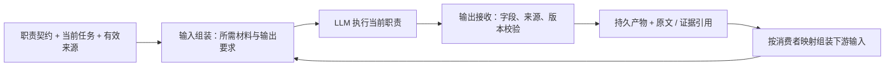

# Context 工程调研：职责输入、模型输出与下游交接

调研日期：2026-10-03。三个 `gpt-6-luna / max` 子 agent 分别调查论文、编排框架、编码项目；父 agent 汇总并补查上下文工程综述和 Anthropic 工程文章。只读研究，无安装、运行测试或效果实测。工程实现仍以 [架构合同](architecture.md) 为基线，本文中的采用方式是研究建议。

## 1. 要解决的具体问题

用户强调：不同职责应获得完成本职工作所需的输入，同时明确模型应输出什么、哪些结果交给下游。前版设计侧重检索、预算和恢复，缺少输出与消费者关系。

建议用一份职责契约连接五项内容：**职责目标、所需输入、允许的操作、期望输出、下游消费关系**。职责可以是同一模型的不同阶段，也可以是独立 agent 的任务；职责数量不决定 agent 数量。下面的方案/实现/核对仅作为首轮例子，不强制所有小任务都经过完整流水线。

## 2. 论文：哪些机制值得借鉴

| 论文与实际阅读范围 | 机制证据 | 对本项目的启示与限制 |
| --- | --- | --- |
| [MetaGPT（ICLR 2024）](https://proceedings.iclr.cc/paper_files/paper/2024/hash/6507b115562bb0a305f1958ccc87355a-Abstract-Conference.html)，第 3.1–3.3 节、第 4 节；[正文](https://ar5iv.labs.arxiv.org/html/2308.00352) | 角色描述之外有共享消息池和订阅机制；按兴趣选择消息并等待前置依赖。PRD、设计、文件清单、数据结构/接口等产物连接后续职责。 | 借鉴输入订阅、前置依赖和产物交接；实验未单独证明这三者的因果收益，不能照搬组织化软件公司流水线。 |
| [ChatDev（ACL 2024）](https://aclanthology.org/2024.acl-long.810/)，第 3、4、6 节 | 分设计、编码、测试阶段；同一 LLM 可承担不同对话角色。阶段内保存对话，跨阶段传递前序 solution；通过标记提取结论。 | 借鉴阶段产物交接；文本标记不是严格结构/事实校验。原型任务实验不能保证复杂真实工程质量或成本。 |
| [Agentless（2024 起）](https://arxiv.org/abs/2407.01489)，第 3、5–6 节 | 定位阶段用 issue、仓库树及代码骨架缩小范围；修复阶段看选定位置周围代码并输出规定补丁；验证阶段执行测试筛选补丁。 | 职责输入与输出可在固定阶段中明确，无需不同角色 agent。SWE-bench 结果有任务与测试有效性边界，不是本插件效果证明。 |
| [Lost in the Middle（TACL 2024）](https://aclanthology.org/2024.tacl-1.9/)，实验设置、结果及开放域 QA 分析 | 控制相关信息的位置与上下文长度，观察到多个受测模型对中间位置信息利用较差；加入更多材料的收益有限。 | 应测关键输入是否被找到、是否遗漏及噪声干扰；论文测 QA/检索，不证明固定 4 KiB 预算最优或短输入必然更好。 |

[A Survey of Context Engineering for Large Language Models（2025）](https://arxiv.org/abs/2507.13334) 的摘要把领域分为检索/生成、处理、管理，再讨论 RAG、记忆、工具推理和多 agent 组合。本次只补读摘要作范围定位，没有审阅其全部 166 页或用其文献数量作为证据强度。

## 3. 项目：输入、输出和交接怎样落地

### LangGraph / LangChain

`StateGraph` 支持图输入、内部状态、图输出以及节点输入的字段集合。节点返回部分状态更新；`Command(update=..., goto=...)` 明确传哪些数据、转向哪个节点。checkpointer 保存线程状态，Store 用于跨线程信息；纯内存 checkpointer 不提供进程重启后的持久恢复。[Graph API](https://docs.langchain.com/oss/python/langgraph/graph-api)、[Persistence](https://docs.langchain.com/oss/python/langgraph/persistence)。

节点状态字段与实际发送给模型的 messages 是两层。官方上下文示例用 `request.override(messages=...)` 改写单次模型请求，交接示例也显式选择消息；把包含完整历史的 messages 字段交给模型，节点 schema 不会替它裁剪历史。[Context engineering](https://docs.langchain.com/oss/python/langchain/context-engineering)、[Handoffs](https://docs.langchain.com/oss/python/langchain/multi-agent/handoffs)。

`TypedDict` 不是逐值运行时验证器。入口只写匹配的 input channels，未知键记录 warning 后忽略；output schema 选择最终输出 channels。节点也可更新整体图中不属于自身输入的 channels。需要拒绝错类型、未知字段或无效引用时，本项目应在边界显式校验，不能把类型声明或字段选择视为已执行的安全检查。[`map_input`](https://github.com/langchain-ai/langgraph/blob/main/libs/langgraph/langgraph/pregel/_io.py)、[`StateGraph`](https://github.com/langchain-ai/langgraph/blob/main/libs/langgraph/langgraph/graph/state.py)。

**建议借鉴**：职责所需字段、状态更新、显式消费者和路由；首轮无需引入完整 LangGraph 服务。

### Letta

memory block 用 label、description、value 和 limit 表达命名信息块，可只读、附加或分离；附加后进入提示词，而不是先检索才读取。适合稳定规则与工作信息，常驻材料同时占用上下文。[Memory blocks](https://docs.letta.com/v1-sdk/memory/memory-blocks)、[附加/分离 blocks](https://docs.letta.com/tutorials/attaching-detaching-blocks/)。

Letta Code 的公开 prompt 区分近期消息、摘要、memory blocks 和 MemFS；文件记忆通过 Git 保留演进，当前提示词与已保存记忆的更新生效时间需要区分。Git 留下来源历史，不证明摘要语义正确；API 暴露 limit 也不能替代对全部写入路径的核验。[Letta Code prompt](https://github.com/letta-ai/letta-code/blob/main/src/agent/prompts/letta.md)。

**建议借鉴**：稳定职责规则、任务临时信息与持久事实分层；沿用 SoL 证据存储，无需再建设完整记忆平台。

### OpenHands software-agent-sdk

`AgentContext` 组合指导信息；项目材料可以按关键词或路径触发。对话压缩由 `LLMSummarizingCondenser` 独立处理，使用事件数/token 条件，并保留开头与近期事件、考虑工具调用边界。[`AgentContext`](https://github.com/OpenHands/software-agent-sdk/blob/main/openhands-sdk/openhands/sdk/context/agent_context.py)、[`LLMSummarizingCondenser`](https://github.com/OpenHands/software-agent-sdk/blob/main/openhands-sdk/openhands/sdk/context/condenser/llm_summarizing_condenser.py)。

`Condensation` 记录省略事件 ID、摘要、插入位置及摘要模型响应 ID；事件日志与派生模型视图分开。TaskAction / TaskObservation 和管理器用任务、子代理、父会话及状态关联执行与恢复；任务结果正文仍为文本，没有统一证据引用契约。[压缩事件](https://github.com/OpenHands/software-agent-sdk/blob/main/openhands-sdk/openhands/sdk/event/condenser.py)、[任务契约](https://github.com/OpenHands/software-agent-sdk/blob/main/openhands-tools/openhands/tools/task/definition.py)、[任务管理](https://github.com/OpenHands/software-agent-sdk/blob/main/openhands-tools/openhands/tools/task/manager.py)。

**建议借鉴**：任务/产物身份、日志与展示视图分离、恢复关联；触发式项目指导只是来源机制，不要求本插件新增 Skill，也不能把 SDK 的历史重写能力直接归给 Codex 插件。

### Aider

Architect 提示要求明确修改说明，`ArchitectCoder.reply_completed()` 将该回复交给 editor；切换时保留相关文件与元数据，清空编辑器消息历史并关闭此次 RepoMap。交接具有职责边界，但产物主体为自由文本。[Architect 提示](https://github.com/Aider-AI/aider/blob/main/aider/coders/architect_prompts.py)、[Architect → Editor](https://github.com/Aider-AI/aider/blob/main/aider/coders/architect_coder.py)。

RepoMap 预算与历史摘要阈值分别配置；RepoMap 是定位线索，需要完整源码时另行加入文件。历史摘要保留近期尾部；这些局部预算不等于强制总模型请求 token 上限。[历史摘要](https://github.com/Aider-AI/aider/blob/main/aider/history.py)、[模型配置说明](https://github.com/Aider-AI/aider/blob/main/aider/website/docs/config/adv-model-settings.md)。

**建议借鉴**：轻量职责切换和按需材料；补上自由文本交接缺少的输出校验、来源版本和证据绑定，不复制另一套编辑器或精确调用图。

## 4. 对本项目的实施建议

以下是父 agent 综合判断，不是任何单篇论文已经验证的效果。

### 用职责契约决定 Context

每个职责只需先明确：目标；必需/可选输入与读取入口；允许的操作；期望模型产物与验收方式；消费者及字段映射。具体职责由真实任务决定，不以职位名称生成大量角色。

| 职责例子 | 注入给模型 | 要求模型产出 | 交给下游 |
| --- | --- | --- | --- |
| 定位与方案 | 用户目标、相关职责/契约、已有能力候选、约束 | 归属、复用/扩展/新增决定与理由、影响范围、验收条件、未解决项 | 实现接收已选方案、范围、契约与依据；保留候选查询引用，不复制整段调查对话 |
| 实现 | 已选方案、目标代码、公共接口、直接使用方、错误/取消责任 | 受管修改；实际变化和验证回执引用；接口变化说明及未完成项 | 核对接收目标、实际 diff、接口变化与有效回执，不把作者自述当测试结果 |
| 核对与收尾 | 验收条件、当前输入、真实 diff、声明/事实差异、必需检查及覆盖边界 | 未解决问题与证据；说明需修复、需补充查询或可收尾的依据 | 修复接收具体问题/位置；协调器按有效证据决定是否完成 |

规划产物、实际变化、测试回执分别标明来源。一个失败但结构正确的检查结果应交给修复职责，而非被丢弃；未经校验或已过期的产物不能作为“已满足前置条件”的依据。

### 两个接口，连接而不混合

- **上下文接口**：按职责构建模型输入，包含所需信息、输出要求和下游交接说明。普通只读查询仍可直接返回答案与来源，不创建写入变更。
- **产物接口**：模型提交结果后，校验结构与关联，保存原文和版本，发布下游可读的产物。带入任务身份、职责身份、所用上下文/源码版本、未解决项和证据引用；不要求把所有大内容复制进 JSON。

显式结构校验可复用现有 Zod/Ajv，证据引用复用 ObservationStore / recall，完成状态归变更协调器。声明字段齐全不能证明复用决定正确；语义判断仍需代码、测试和适用审查。Context 模块不复制另一份任务事实或重新执行验证。

[Anthropic 的上下文工程实践](https://www.anthropic.com/engineering/effective-context-engineering-for-ai-agents)介绍按需读取、持久记录和子 agent 隔离；其[研究系统经验](https://www.anthropic.com/engineering/multi-agent-research-system)强调明确任务边界与输出格式，也使用持久产物引用减少多次摘要的信息损失。这是工程经验，不能把研究任务效果或成本数据直接外推到编程插件。

### 首轮边界

先验证两项能力：按职责选择输入；接收一份输出并形成下游输入。可以用同一模型分阶段，不默认建立大型多 agent 系统。4 KiB 继续作为初始有界包预算，详细源码通过工具展开；它不等于整个模型请求的预算，也不是论文证明的最优值。

当前 Codex 插件方案控制新增包和受管输出；在同一聊天切换职责不会清除此前历史。严格隔离需要宿主提供独立上下文及交接能力，必须另行验收。首轮不能把“字段筛选”写成“全量上下文隔离”。

## 5. 最小验证与未验证事项

用“共享重试能力的复用与修改”作一条贯穿任务，检查：

1. 两个职责收到各自必需材料，模型能指出来源；输入选择没有省掉错误、取消与兼容约束。
2. 输出缺少必需字段、消费者关联错误、引用缺失或基础版本过期时，给出具体诊断；不得静默补成有效产物。
3. 结构正确但方案语义错误时，代码核对/真实测试能发现问题；不以 schema 通过替代任务成功。
4. 失败与中断后保留真实产物和未解决项，恢复不会重复执行已经发生的修改。
5. 比较原有上下文方式与职责输入/产物交接方式的任务结果、漏召回、错误交接、总回合、可见字节或可靠 token、总耗时，计入维护开销。

本次未安装/运行外部项目，未锁定所有 GitHub main 文档到不可变 commit，未在 Codex Desktop/CLI 验证新增 Context。引用为调研时读取的官方资料；实施选型前仍需固定实际采用版本并验证。

本文不建设框架平台，不强制 PRD→架构师→工程师→QA 全流程，不为职责自动新增 Skill，不声称已节省 token 或已实现全局上下文隔离。
